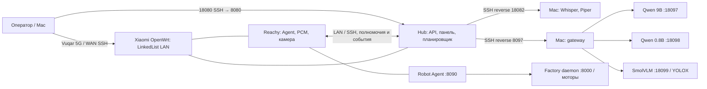

# Состав текущей системы

Срез установки: 14 ноября 2026. Файлы и версии ниже получены с устройств, а не
только из старых инструкций. `deploy/current/manifest.json` связывает каждый
шаблон с конечным путём, владельцем, правами и SHA-256. Итоговые проверки
согласованности находятся в `deploy/current/observations/verification.json`.

## Узлы и поток данных

| Узел | Платформа и адрес | Размещение проекта | Назначение |
|---|---|---|---|
| Mac | M1 Pro, 32 GB, macOS 26.6.2 (25G83), Wi-Fi `192.168.100.31` | `/Users/notanonenough/workspaces/reachy-companion` | Модели, STT/TTS, шлюз вычислений, SSH-туннели, команды оператора |
| Hub | Raspberry Pi, Debian 13.7, Python 3.13.5, `192.168.0.186` | `/home/deploy/reachy-companion` | API/панель, маршрутизация речи, автономный цикл, память и полномочия |
| Reachy Mini | Reachy Mini OS v0.2.3 / Debian 13.3, `192.168.0.184` | `/home/pollen/reachy-companion` | Микрофон, динамик, камера, локальный Agent, заводской контроллер приводов |
| Xiaomi | Mi Router 4A Gigabit v2, OpenWrt 25.12.6, LAN `.0.1`, WAN `.100.45` | Конфигурация `/etc/config/`; Python-проект не запускается | AP LinkedList, DHCP/DNS, NAT/firewall, SSH jump host |

Hub и робот сейчас подключены к **LinkedList 5 GHz**. Ethernet Hub отключён
от автоподключения и без carrier. Mac находится в сети **Vuqar 5G**; Xiaomi
подключается к ней как Wi-Fi STA и одновременно обслуживает LinkedList.
Mac и Xiaomi используют MTU 1492 на соответствующем uplink. Статические DHCP
назначения Hub/Reachy закреплены в router `dhcp.template`; правило WAN SSH
разрешает доступ с Mac `.100.31`. При смене адреса Mac это правило надо изменить.

## Процессы и запуск

### Hub: systemd

| Unit | Точка входа / интерфейс | Устройство и обязанности |
|---|---|---|
| `reachy-hub.service` | `python -B -m reachy_companion --config …/config.local.json hub serve`, TCP 8080 | `hub.py`: API, HTML-панель, действия оператора, связь с Agent, диагностика, передача разрешённых движений. Базовый постоянно включённый сервис. |
| `reachy-voice.service` | тот же CLI, `voice serve`, TCP 8081 | При `voice.mode=remote` запускает `router.py`: принимает речевые задачи, пересылает на Mac через `127.0.0.1:18082`. Инференс на Hub не выполняется. |
| `reachy-robot-tunnel.service` | `/usr/bin/ssh -N … reachy-tunnel@reachy-mini.local` | Постоянные локальные forwards к заводскому API, Agent, PCM и камере; отдельный ограниченный SSH-пользователь, ключ и known_hosts. |
| `reachy-production.service` | `deploy/autonomous/production_start.py hub` | Владелец автономного сеанса: решения, контекст, аудио, движение, память; `/status` на loopback 8791. Создаётся явным `production-control start`; `Restart=no`, не включён в загрузку ОС. |
| `reachy-network-qos.service` | `nft -f /etc/reachy-network-qos.nft` | Настройка приоритетов сетевого трафика; oneshot/RemainAfterExit. |
| `reachy-report-retention.timer` → `.service` | `reachy_companion.production_logs prune` | Ежедневная очистка отчётов и ограничение хранения; точные лимиты в unit. |
| `pi-wifi-diagnostics.service` | `/usr/local/sbin/pi-wifi-diagnostics` | Диагностика Wi-Fi после загрузки, вывод в `/boot/firmware/wifi-diagnostics.log`. Не демон принятия решений. |

Проектный Python: `ROOT/.venv-router/bin/python`; исходники всех проектных units:
`ROOT/current/src`. Настройки и изменяемые данные остаются в `ROOT`, вне релиза.

### Reachy: systemd и оборудование

| Unit | Точка входа / интерфейс | Обязанности |
|---|---|---|
| `reachy-mini-daemon.service` | `ROOT/u96-safe-launcher.sh` → `/venvs/mini_daemon/bin/python -u -m reachy_mini.daemon.app.main`, TCP 8000 | Заводской SDK 1.2.11, камера, шина приводов, состояние, GPIO shutdown. Python 3.12.12; запуск без автоматического wake/sleep. Не является кодом Companion. |
| `reachy-mini-bluetooth.service` | `/usr/bin/python3 /bluetooth/bluetooth_service.py` | Заводская BLE-настройка Wi-Fi и команды восстановления/перезапуска. Исходники утилиты и shell-команд сохранены в `deploy/current/robot/factory/`. |
| `reachy-voice-agent.service` | `ROOT/.venv/bin/python -B -m reachy_companion … agent serve`, TCP 8090 | Единственная локальная точка управления микрофоном, громкостью, разрешениями и владельцами. Проверяет epochs, deadlines, STOP, режим разговора; выполняет санкционированные действия через заводской API. |
| `reachy-production-audio.service` | `production_start.py device` → `device_audio_runtime.py` | PCM capture/playback, подключённый к Hub; TCP 8780 (данные), 8781 (отдельный STOP), UDP 8782 (lease). `Restart=no`; самостоятельного автозапуска нет. |
| `reachy-camera-sensor.service` | factory Python → `reachy_companion.autonomous.camera_sensor`, loopback 8794 | Периодические кадры через SDK, проверка разрешения камеры, latest-frame интерфейс. `PartOf=reachy-production-audio`, стартует вместе с сеансом. |
| `reachy-companion-firewall.service` | CLI `firewall apply` | Правила локальной сетевой границы. NetworkManager dispatcher повторно применяет правила при изменении сети. |
| `reachy-network-qos.service` | nft rules | Приоритизация сетевых каналов. |
| `reachy-report-retention.timer` → `.service` | `production_logs prune` | Удаление старых локальных диагностических отчётов. |

Companion использует Python 3.13.5 в `ROOT/.venv`, factory daemon — отдельный
Python 3.12.12. Они не взаимозаменяемы: камера зависит от factory environment,
GStreamer и библиотек из образа ОС. `~/.asoundrc` задаёт общий ALSA dmix/dsnoop:
карта 0, устройство 0, 16 kHz, два канала, periods 1024, buffer 4096.

В SDK есть ровно зафиксированный патч `get_status`: возвращаются актуальные
`ready.is_set()` и `last_alive`. Preimage, patch и итоговый файл проверяются
SHA-256; патч лежит в `deploy/current/robot/vendor/`.

### Mac: launchd

Все шесть plists лежат в
`~/Library/Application Support/Reachy Companion/LaunchAgents/`. Они имеют
`KeepAlive=true`, `RunAtLoad=false`; загрузкой/выгрузкой управляет
`scripts/production-control`. Обёртка `production_logs run` ограничивает логи
до 5 MiB с тремя архивами; gateway также держит Mac бодрствующим.

| Label | Процесс и порт loopback | Настройки и ответственность |
|---|---|---|
| `local.reachy.llm` | `~/.local/bin/llama serve`, 18097 | Qwen3.5-9B Q4_K_M, alias `reachy-main9b`, context 8192, один слот, Metal/ngl99, reasoning off, cache RAM512. Основная генерация решений/ответов. |
| `local.reachy.fast` | llama, 18098 | Qwen3.5-0.8B Q8_0, alias `reachy-fast`, context4096, один слот, Metal/ngl99, cache128. Быстрые решения и маршрутизация. |
| `local.reachy.vlm` | llama, 18099 | SmolVLM2-500M Video Q8_0 + projector, context2048, CPU/ngl0, два потока, пониженный приоритет, cache0. Описание изображения. |
| `local.reachy.worker` | CLI `worker serve`, 8082 | `voice.py`/`transcription.py`: faster-whisper medium CPU int8 beam1; Piper ru_RU-ruslan-medium; SoX для аудиопреобразования; модели локальны. |
| `local.reachy.gateway` | `observer_service.py gateway`, 8097 | `autonomous/gateway.py`: авторизация токеном, допуск задач к моделям, зрение/YOLOX, нормализация ответов, relay памяти и доставки S3. |
| `local.reachy.tunnels` | `ssh -N -T reachy-hub` | Двусторонние пробросы API/моделей между Mac, Hub и Reachy. Сам не считает и не управляет приводами. |

Точная llama-сборка: b11941 / commit `19ff817fb`, версия `0.7.0-dev`.
Большие модели не хранятся в Git: `artifacts.lock.json` фиксирует источник,
ревизию, размер и SHA-256 каждого файла, включая tokenizer/vocabulary Whisper.
Там же закреплены установленный бинарник llama и точная копия локального SoX.

### Router: OpenWrt

Своих Python/Node-сервисов Companion здесь нет. Прошивка запускает стандартные
`netifd`, `dnsmasq`, `firewall4/nftables`, `dropbear`, `uhttpd`, `rpcd`, Wi-Fi
службы и системные службы. Установленные пакеты целиком перечислены в
`deploy/current/router/os-packages.txt`; все 11 UCI-конфигов сохранены в
`router/uci/`. Дополнительно сохранены `rc.local`, `sysctl.conf`, `board.json`
и шаблон SSH authorized_keys. Серийные значения Wi-Fi и ключи подставляются
из отдельного закрытого файла.

## Порты и сетевые границы

| Откуда | Куда | Назначение |
|---|---|---|
| Mac localhost18080 /18081 | Hub8080 /8081 | Панель/API и voice router |
| Mac localhost18090 /18000 | Hub18090 /18000 → Robot8090 /8000 | Agent и factory API через две ступени SSH |
| Mac localhost18794 | Hub18794 → Robot8794 | Камера |
| Hub localhost18082 /18097 /8097 | Mac8082 /18097 /8097 | Reverse SSH: worker, основной LLM, gateway |
| Hub localhost18780 /18781 | Robot8780 /8781 | SSH-каналы PCM/STOP, доступны для соответствующих инструментов |
| Hub192.168.0.186 | Robot192.168.0.184:8780/8781/8782 | Текущий production использует прямой доверенный LAN: PCM, STOP, lease |
| Mac192.168.100.31 | Router192.168.100.45:22 | Jump host для SSH к LAN |

Наличие порта не означает действующий сеанс. Production PCM и status появляются
только при запуске соответствующих служб. HTTP API Companion используют bearer
ключ; прямой PCM работает с протоколом полномочий на доверенном LAN, а не как
публичный интернет-сервис. Полные bind/forward параметры находятся в шаблонах.

## Как устроен автономный цикл

1. `production-control start` проверяет доступность Mac, получает новый сеанс,
   запускает device и hub services. `production_start.py` связывает конфигурацию,
   адаптеры и lifecycle. Повторный старт не происходит после STOP автоматически.
2. `runtime.py`, `state.py`, `contracts.py`, `services.py` ведут этапы цикла,
   события и бюджет времени. Lease, owner, boot/session epochs и срок полномочий
   связывают каждый side effect с текущим сеансом.
3. `audio_peer.py`/`audio_adapter.py`, `alsa_*`, `playback.py` доставляют PCM;
   отдельные STOP/lease каналы не зависят от очереди больших аудиопакетов.
   `transcription.py` управляет STT и его отменой/занятостью.
4. `gateway.py`, `context.py`, `voice_chain.py`, `speech_adapter.py` формируют
   запрос, выполняют модель и TTS; ответ проходит до воспроизведения через
   проверку актуальности состояния. `person_follow.py` и `visual_attention.py`
   выбирают визуальную цель; `object_detector.py` использует YOLOX.
5. `stock_motion_adapter.py` проводит движения через существующий Agent/factory
   API. `motion_policy.py`, `motion_limits.py`, `actuator_guard.py` ограничивают
   допуск и геометрию. Нативные экспериментальные драйверы не являются текущим
   исполнительным контуром.
6. `memory.py`, `durable.py`, `experience.py` сохраняют опыт и очередь доставки;
   журналы/память находятся в `data/`, S3 credentials — только в `secrets/`.

## Панель и постоянные настройки

`control_page.py` генерирует HTML/JavaScript, `hub.py` принимает команды и
пересылает их Agent. `conversation_mode.py`, `microphone.py`, `volume.py`,
`camera_permission.py`, `motion_policy.py`, `durable_intent.py` хранят намерение
оператора и проверяют его актуальность. Разрешение камеры открывает доступ
компаньона к кадрам; не отключает физическое питание камеры. Разрешение движения
не передаёт чужой действующий owner новому процессу. STOP закрывает доступ к
микрофону, камере и движениям. Перезапуск не восстанавливает старые leases.

Наблюдавшиеся настройки вынесены в `observations/operator-settings.json`.
Этот файл **не импортируется автоматически**: boot IDs, owner IDs, epochs,
дедлайны, очереди действий и активные полномочия нельзя переносить на свежую ОС.

## Служебные команды и альтернативные подсистемы

| Каталог / файл | Роль и статус |
|---|---|
| `scripts/production-control`, `reachy-on`, `reachy-off` | Действующий операторский start/stop/status и управление питанием вычислительной части Mac |
| `scripts/diagnose-conversation` | Диагностика текущего голосового тракта |
| `deploy/current/manage.py` | Рендер, установка с backup и сверка конфигурации; сам не запускает службы |
| `deploy/current/release.py` | Архив только чистого закоммиченного дерева и проверка всех файлов релиза |
| `deploy/current/artifacts.py` | Загрузка и проверка закреплённых моделей/бинарников |
| `deploy/current/robot/vendor/apply.py` | Проверка/применение единственного зафиксированного SDK-патча |
| `deploy/autonomous/production_start.py`, `device_audio_runtime.py`, `observer_service.py` | Три действующие точки запуска Linux/Mac |
| Остальные `deploy/autonomous/*probe.py`, `*fixture*`, `smoke*` | Проверки отдельных контрактов и оборудования, не фоновые службы; часть затрагивает устройство при явном запуске |
| `deploy/autonomous/prepare_*`, `agent_update.py`, `deploy/patches/` | Исторические миграции и preimage fixtures для регрессий. Не путь установки актуальной схемы |
| `deploy/production/install_*.py` | Предыдущие инкрементальные установщики; заменены manifest-процессом. Не применять поверх текущего baseline |
| `native/`, `autonomous/native_*`, `factory_head_*` | Экспериментальный нативный контур, fencing и стендовые проверки; не запущен в текущем production |
| `scripts/windows/`, `*.ps1`, `worker/`, `worker_container.py` | Поддержка Windows/Docker вычислительного узла; текущий узел — Mac |
| `deploy/workflows/`, `autonomous/workflows.py` | Broker/n8n workflow-интеграции и тесты; в текущих четырёх узлах не запущены |
| `profiles/`, `scenarios/`, `config*.example.json` | Примеры режимов и сценариев; актуальные значения установленных узлов — только в `deploy/current/*/config/` |
| `tests/` | Unit/integration/контрактные регрессии; исторический Git нужен части preimage-тестов |

Исторические фикстуры и альтернативные реализации сохранены там, где они
нужны тестам или отдельным инструментам. Они не объявляются установленными
сервисами. Ревью активной системы следует начинать с manifest, points of entry
и следующих модулей, а не со старых deploy-патчей.

## Полный каталог Python-модулей

Пути ниже относительны к `src/reachy_companion/`. Последняя колонка показывает
ключевые объявления верхнего уровня, чтобы быстро найти реализацию; подробные
контракты и ограничения находятся в коде и соответствующих тестах.

| Модуль | Назначение из исходника | Основные объявления |
|---|---|---|
| `__init__.py` | Reachy Companion: configurable local robot conversation and scenarios. |  |
| `__main__.py` | Точка CLI | `main` |
| `agent.py` | Reachy Mini microphone/speaker bridge. Uses the daemon's shared ALSA devices. | `validate_stream_timing`, `Agent`, `main` |
| `alsa_role_observer.py` | Read-only ALSA role observations; unknown children never prove absence. | `observe_roles` |
| `autonomous/__init__.py` | Opt-in shadow cognition. Never imported by the production services. |  |
| `autonomous/__main__.py` | Separate opt-in entrypoint; does not deploy or import hardware services. | `main` |
| `autonomous/actuator_guard.py` | Local actor ownership and expiring leases; no hardware adapter is enabled here. | `GuardRejected`, `Lease`, `OutputGate`, `ActuatorGuard` |
| `autonomous/alsa_capture.py` | Owned nonblocking capture with explicitly monotonic ALSA timestamps. | `Timespec`, `AlsaCapture` |
| `autonomous/alsa_pcm.py` | Optional owned nonblocking libasound PCM backend. No aplay/wall-time cursor. | `AlsaPCM` |
| `autonomous/audio_adapter.py` | Latest-only captured utterances -> one occupied PC STT slot -> fresh events. | `HttpSTT`, `AudioAdapter` |
| `autonomous/audio_peer.py` | Authenticated audio peer: finite by default, with an opt-in sequenced lease. | `stream_identity`, `owner_binding`, `lease_authority`, `AudioPeer`, `create_server`, `PeerClient`, `PersistentPeer`, `RemotePCM` … |
| `autonomous/audio_session_control.py` | Owner-fenced status/stop for one finite Hub session; no device-start API. | `create_server`, `SessionClient`, `cleanup_receipts` |
| `autonomous/camera_relay.py` | Video-only camera IPC replacement while factory motor daemon is withdrawn. | `CameraRelay` |
| `autonomous/camera_sensor.py` | Robot camera stream measurements, without audio, actuators or stored frames. | `Measurements`, `CameraSensor`, `main` |
| `autonomous/companion_session.py` | Normal joined companion: finite by default, or an explicit existing-owner lease. | `SessionFailure`, `read_speech_operator`, `ContextGateway`, `occupied`, `session_context`, `run_session`, `main` |
| `autonomous/config.py` | Explicit opt-in profile independent from the running companion config. | `context_mode`, `load` |
| `autonomous/context.py` | PC latest-only video cache and persistent memory, independent of inference lanes. | `LatestVideo`, `ContextProvider` |
| `autonomous/contracts.py` | Typed authority and bounded projection; wire validation uses the design schema. | `uid`, `validator`, `validate`, `decode`, `Authority`, `Binding`, `Sensor`, `Task` |
| `autonomous/durable.py` | Transactional local state and an at-least-once, privacy-safe delivery outbox. | `DurableStore`, `Delivery` |
| `autonomous/factory_head_adapter.py` | Finite native .3 bridge for an already-open, fenced factory process. | `absolute_ns`, `verify_native_clock`, `NativeHeadBridge` |
| `autonomous/factory_head_entry.py` | Runner entry for one fresh, source-pinned existing factory/private head IPC. | `pose_matrix`, `measured_pose`, `operator_reader`, `main` |
| `autonomous/factory_head_fence.py` | Temporary factory transport fence; no import installs or mutates anything. | `FactoryReadOnlyASGI`, `install_backend_read_fence` |
| `autonomous/factory_head_guard.py` | Finite head admission core for an adapter inside the existing factory daemon. | `number`, `pose`, `head_plan`, `policy_binding`, `HeadAction`, `locked`, `FiniteHeadGuard` |
| `autonomous/factory_head_handoff.py` | Pure Phase B no-output plan/admission; never opens UART or controls a unit. | `canonical`, `digest`, `PhaseBPlan`, `freeze_plan`, `authorize_takeover`, `authorize_candidate`, `assess_readonly` |
| `autonomous/factory_head_kinematics.py` | Process-local bounded analytical FK/IK over the factory's exact mutable model. | `reject_existing_instances`, `verify_kinematics`, `install_bounded_kinematics` |
| `autonomous/factory_head_process.py` | Prepare a fresh existing-factory ASGI process without starting its lifespan. | `verify_source`, `prepare_factory_app`, `ready_factory_backend` |
| `autonomous/factory_head_runtime.py` | Finite scheduler/private Unix IPC for a reviewed already-open factory. | `FactoryHeadRuntime`, `PrivateFactoryHeadIPC` |
| `autonomous/factory_head_sample.py` | Read-only sampling through an already-open factory motor controller. | `raw_bytes`, `xl330_position`, `ExistingFactorySampler`, `installed_v156_admission` |
| `autonomous/factory_head_startup.py` | Pin and fence the vendor's pre-controller reflash path, process locally. | `review_startup`, `install_startup_fence`, `startup_fence_intact` |
| `autonomous/gateway.py` | PC-only model gateway, bounded execution permits and exact tokenizer admission. | `BudgetRejected`, `ExecutionUnknown`, `ModelBackend`, `fast_schema`, `fast_tuple_schema`, `tuple_choice`, `fast_projection`, `Gateway` … |
| `autonomous/header_observer.py` | Finite Linux kernel-truncated Ethernet/IPv4/UDP metadata observer. | `flow`, `compile_filter`, `evaluate`, `Instruction`, `Program`, `attach`, `open_capture`, `receive_header` … |
| `autonomous/lease_datagram.py` | Finite authenticated challenge/renewal datagrams for the device audio lease. | `key`, `signed`, `verified`, `LeaseDatagramServer`, `DatagramRenewal` |
| `autonomous/memory.py` | PC-owned bounded provenance store. APIs are trusted-owner operations, not tools. | `MemoryConflict`, `stamp`, `normalized_claim`, `same_claim_value`, `MemoryStore` |
| `autonomous/motion_adapter.py` | Hub bounded antenna adapter. Inference only proposes; current actor gates dispatch. | `MotionAdapter` |
| `autonomous/motion_runtime.py` | Reusable bounded native service. Caller must establish the root deployment fence. | `MotionRuntime`, `RuntimeServer` |
| `autonomous/native_agent.py` | Observe the existing normal Agent; never acquire audio or conversation work. | `endpoint`, `NativeClient`, `identity`, `motor_identity`, `transient_read`, `StockNotSent`, `NativeReadExpired`, `guarded_control` … |
| `autonomous/native_agent_session.py` | Native Agent observer: finite by default; explicit observation-only service. | `NativeGateway`, `occupied`, `validate_lifecycle`, `MetadataSnapshots`, `run_native_session`, `exit_code`, `main` |
| `autonomous/native_config.py` | Explicit default-off owner profile; no token or device initialization. | `load` |
| `autonomous/native_motion.py` | Single serial writer and finite antenna trajectories with measured hold stop. | `crc16`, `read_packet`, `status_value`, `Driver`, `HoldActor` |
| `autonomous/network_observation.py` | Reachability observed by existing HTTP jobs; no extra probes or ICMP claim. | `NetworkObservation` |
| `autonomous/object_detector.py` | Local object localization; never called by the scheduler or HTTP handler. | `ObjectDetector` |
| `autonomous/pcm_controls.py` | Bounded PCM controls and aggregate diagnostics; no device or owner creation. | `samples`, `Levels`, `PcmGain`, `StereoChannels`, `CaptureExclusion` |
| `autonomous/perception.py` | Bounded PC pixel measurements. No object labels or scene inference from metrics. | `pixel_metrics`, `shadow_event` |
| `autonomous/person_follow.py` | Pure bounded head/body planner. Inputs are image boxes and measured poses. | `checked_sample`, `clamp`, `smooth_error`, `measured_pose`, `PersonFollow` |
| `autonomous/playback.py` | Bounded PCM adapter. Backend receipts, never elapsed time, authorize resume. | `Playback`, `ReplayPCM` |
| `autonomous/production.py` | Deployment hooks for the single Scheduler in companion_session. | `http_reader`, `attach`, `main` |
| `autonomous/response_endpoint.py` | Finite speech endpoint for a captured response, without speaker identity. | `ResponseEndpoint` |
| `autonomous/runtime.py` | Inference-free hub scheduler. One actual request per available clock tick. | `Job`, `RemoteGateway`, `ReplayGateway`, `Scheduler` |
| `autonomous/scene_changes.py` | Bounded semantic novelty, independent of pixel brightness and image movement. | `checked_objects`, `SceneChanges` |
| `autonomous/services.py` | Background IO slots for the existing Scheduler; never an independent agent. | `Services` |
| `autonomous/signal_stop.py` | Event-compatible stop flag whose signal handler never acquires a lock. | `SignalStop` |
| `autonomous/speech_adapter.py` | Scheduler -> bounded TTS stream -> owned PCM. Explicit local audio opt-in. | `HttpTTS`, `SpeechAdapter` |
| `autonomous/state.py` | Single-owner reducer. All actuations are entries in a bounded simulated ledger. | `utc`, `State` |
| `autonomous/stock_motion_adapter.py` | Finite stock-daemon expressions through Hub's permission and UUID fences. | `StockMotionAdapter` |
| `autonomous/video_adapter.py` | PC-only bounded latest-frame processing; no camera/audio/model imports. | `identity`, `FrameOrder`, `decode_packet`, `LatestFrameProcessor` |
| `autonomous/vision.py` | Mac-only, latest-frame VLM lane. No inference on a scheduler/HTTP thread. | `Vision` |
| `autonomous/visual_attention.py` | Single-owner visual initiative; no model calls or actuator IO here. | `VisualAttention` |
| `autonomous/voice_chain.py` | Hash-only causal receipt checks; trusted runner files are not attestations. | `digest`, `model_final`, `checked_final`, `speech_main`, `retain_main_audit`, `context_binding`, `check_context_view`, `check_context_task` … |
| `autonomous/voice_memory_fixture.py` | Trusted-owner disposable acceptance using the existing PC MemoryStore. | `CleanupOwnershipConflict`, `OwnedCleanup`, `cleanup_class`, `operation_lock_class`, `finish_fixture`, `read_json`, `private_json`, `voice_provenance` … |
| `autonomous/windows_fixture_cleanup.py` | Finite local NTFS cleanup under exclusive source/parent/quarantine authority. | `close_after_error`, `FileId`, `FileTime`, `FileInformation`, `Disposition`, `FileStandardInformation`, `RenameInformation`, `WindowsKernel` … |
| `autonomous/workflows.py` | Optional typed broker client. Endpoint/credential never come from model output. | `WorkflowClient` |
| `barge_candidate.py` | Experimental same-reader interruption candidate. Default OFF; not AEC. | `waveform_match`, `own_text_veto`, `BargeCandidate` |
| `barge_in.py` | Capture near-end speech through the robot's hardware AEC while it talks. | `BargeInMonitor` |
| `barge_trial.py` | Default-OFF, finite two-case acoustic trial; existing audio/reader owners only. | `EitherEvent`, `BargeTrial` |
| `brains.py` | Text-only backend boundary: local Qwen, OpenClaw or Hermes Agent. | `ModelExecutionOwnership`, `model_identity`, `http_model_choice`, `raw_prompt`, `answer` |
| `camera_permission.py` | Durable permission to consume camera images; never claims hardware power-off. | `read_permission`, `CameraPermission` |
| `caption_initiative.py` | AUTO-only received-caption question proposal. No camera/audio owner or replay. | `question`, `decide`, `CaptionInitiative` |
| `capture_pump.py` | Opt-in existing mono capture owner; receipts do not prove AEC or acoustic age. | `Utterance`, `Assembler`, `PremaskCanary`, `CapturePump`, `barge_monitor` |
| `client.py` | Реализация client | `request`, `control_authority`, `compare_control_operator`, `guarded_control`, `demo`, `control` |
| `code_identity.py` | Model-independent effective Python source identity; never changes sys.path. | `source_manifest`, `validate_manifest`, `unique_object`, `effective_identity`, `main` |
| `config.py` | One configuration for operator, hub and robot; credentials stay outside JSON. | `Config`, `initialize` |
| `control_diagnostics.py` | Optional RAM-only RPC observers: no retries, I/O, owners or error bodies. | `trace_guarded_control`, `trace_operator_reads` |
| `control_page.py` | Existing authenticated LAN panel; explicit controls, observed state, no automatic opt-in. |  |
| `conversation_context.py` | Explicit conversation context, separate from speaker identification. | `mode_value`, `mode_prompt`, `mode_session`, `mode_payload` |
| `conversation_mode.py` | Saved conversation selection. It grants no audio, initiative or motor authority. | `validate_saved`, `ConversationMode` |
| `deployment.py` | Reproducible SSH deployment and device installation. | `ssh_args`, `ssh`, `deploy`, `fetch`, `download_models`, `service_unit`, `install`, `update` |
| `durable_intent.py` | Explicit durable user intent, never a persisted boot/epoch/owner grant. | `DurableIntent` |
| `emotion_library.py` | Worker-side sampling of adapted, bundled Pollen Robotics emotion curves. | `catalog`, `sample`, `blend`, `step` |
| `experience.py` | Trusted producer adapter over MemoryStore; local projections, never identity inference. | `text`, `mode_value`, `timestamp`, `digest`, `Experience` |
| `expression_player.py` | Robot-side transport of compute-generated plans through the hub. | `ExpressionPlayer` |
| `expressions.py` | Expression selection/planning on the compute worker, not on the hub. | `spoken_segments`, `spoken_expression`, `plan` |
| `finite_alice_trial.py` | One exact external-response window; no speaker identity or acoustic claim. | `CapturedPCM`, `validate`, `ResponseGate` |
| `firewall.py` | Own nftables table only; the rest of the host firewall is never flushed. | `settings`, `active_ap_interfaces`, `recovery_set`, `sync_recovery`, `render`, `run`, `apply`, `remove` … |
| `hub.py` | Small Reachy Mini scenario router; Python standard library only. | `reconciliation_error_class`, `decode_reconciliation_json`, `Hub`, `serve`, `main` |
| `imu_readout.py` | One bounded temperature readout from factory IMU data; no I/O or cache. | `temperature_readout` |
| `initiative.py` | Explicit once-per-arm camera question, consumed by the existing audio loop. | `binding`, `guard`, `local_operator`, `question`, `control_binding`, `Initiative`, `child`, `control` … |
| `intents.py` | Quick action classification precedes prose generation on the compute worker. | `classify`, `classify_with_model` |
| `logging_utils.py` | Реализация logging_utils | `TurnLatency`, `measured`, `measured_chunks`, `worker_latency`, `checked_latency`, `configure` |
| `microphone.py` | Persistent operator microphone switch, independent of temporary test pause. | `validate_control`, `MicrophoneState` |
| `motion_limits.py` | Bounded command validation. No trajectories or inference on the router. | `number`, `validate_steps`, `validate_follow_step` |
| `motion_policy.py` | Durable operator motor/quiet/privacy policy, independent of microphone state. | `MotionPolicy` |
| `motion_proxy.py` | Authenticated Agent boundary to a robot-local, sole-writer Unix service. | `receive`, `send`, `MotionProxy` |
| `owned_http.py` | Pure owned HTTP transport derived from the accepted a4aa socket watchdog. | `need`, `prepare`, `owned_response` |
| `production_logs.py` | Bounded production logging and retention; never removes unfinished sessions. | `report_summary`, `prune_reports`, `run_logged`, `main` |
| `production_status.py` | Bounded, content-free inventory of the installed three-host deployment. | `probe_host`, `normalize_tracking`, `probe_model`, `summarize`, `collect`, `format_human` |
| `provisional_stt.py` | Opt-in rolling-window STT: no intent, action, model reply or conversation memory. | `require`, `enabled`, `binding`, `unique`, `constant`, `decode`, `request`, `parse_request` … |
| `recognition.py` | Speech recognition runs exclusively on the compute PC. | `DecoderBudgetExceeded`, `bounded_whisper_class`, `expected_whisper_hash`, `verified_whisper_cache`, `Recognizer`, `prepare` |
| `replay.py` | In-memory PCM replay: continue the exact original reply, not a new LLM answer. | `ReplayResponse` |
| `router.py` | Hub voice gateway. Standard library only: never imports speech/LLM runtimes. | `Router`, `handler_for`, `main` |
| `semantic_observer.py` | Bounded shared-camera observer, not an actuator or physical camera owner. | `require`, `semantic_result`, `capture_frame`, `child`, `run_child`, `VisualContextCache`, `SemanticObserver` |
| `sensory_bridge.py` | R53 narrow sound -> local model -> existing guarded attention bridge. | `rejection_class`, `raw_decision_payload`, `SensoryBridge` |
| `sensory_loop.py` | Bounded source-only bridge; owns no device, model, transport or permissions. | `ExecutionPermit`, `SensoryLoop` |
| `snapshot_vision.py` | One local snapshot-to-FINAL request; pixels only in Robot/PC RAM. | `need`, `bind_parent_lifetime`, `native_address`, `select_model`, `final_message`, `current_baseline`, `get_models`, `capture_png` … |
| `sound_events.py` | Small audio event model and beat estimation, executed on the compute PC. | `SoundEvents`, `prepare` |
| `sound_monitor.py` | Robot-side bounded audio transport; classification and rhythm run on the PC. | `SoundMonitor` |
| `speech_clock.py` | Wall-time playback estimate; not a measured consumed-PCM cursor. | `SpeechClock` |
| `speech_motion.py` | Compute-side phoneme timing and bounded expressive speech cues. | `pose_step`, `cues` |
| `spoken_reply.py` | Request-scoped spoken-text constraints; no tools, authority or model fallback. | `constraints`, `response_format`, `endpoint`, `validate_text`, `decode_reply`, `check_profile` |
| `spoken_reply_sdk.py` | Optional pinned raw SDK prediction boundary; never load a model on demand. | `PredictionSlot`, `digest`, `template_binding`, `profile`, `environment_audit`, `predict` |
| `spoken_vision.py` | Exact spoken snapshot intent and bounded adapter for the existing Agent. | `failure`, `child_result`, `words`, `matches`, `binding`, `check_operator`, `dispatch`, `child` … |
| `token_stream.py` | Opt-in local completion SSE → bounded semantic segments. | `validate_metadata`, `metadata_rows`, `prepare_endpoint`, `owned_response`, `need`, `unique`, `reject_constant`, `sse_tokens` … |
| `transcription.py` | One remote STT execution slot, with a fence for requests delayed in transit. | `checked_execution`, `TranscriptionBusy`, `TranscriptionSlot` |
| `voice.py` | LAN-only Russian voice pipeline: Vosk -> LM Studio -> Piper. | `speaker_eq_effects`, `Pipeline`, `create_server`, `main` |
| `volume.py` | Saved speaker level; microphone capture controls are never involved. | `validate_percent`, `PlaybackVolume` |
| `worker_container.py` | Docker launcher reads ports and volume paths from the same JSON config. | `main` |
