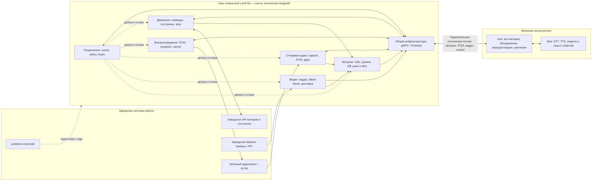

# Локальное аудио и видео Reachy Companion: обнаружение событий и границы службы

Дата исследования: 17 ноября 2026 года. Основание: текущие файлы репозитория и первичные интернет-источники. Устройства не опрашивались; службы, модели, микрофон, камера и движения не запускались. Этот документ — исследование для пересмотра, а не описание уже внедрённой архитектуры.

## 1. Рекомендация и степень уверенности

**Вывод:** на роботе полезен расширяемый слой непрерывного получения данных, быстрых метрик доступных датчиков и исполнения разрешённых команд. Его первая очередь — уровень звука с адаптивным порогом, существующий статистический WebRTC VAD, автомат начала/конца речи, уменьшенное изображение с оценкой изменения, поза/ошибка позы и доступные IMU/DoA. Все метрики и данные поступают в Hub: он совместно их учитывает, определяет маршрутизацию и хранение. Распознавание слов, людей, предметов и смысла события может выполнять Mac по направлению Hub. Полный ROS 2 или voice-agent framework не требуется только ради этих операций.

**Уточнённое направление пользователя:** наш локальный слой — на Go; связь Ричи ↔ Hub — gRPC/Protobuf с общим версионируемым контрактом. Сначала выделяются шесть логических модулей: разрешения, движение, воспроизведение, отправка аудио, видео и метрики. Адаптеры предусматриваются и для источников, и для актуаторов. Число процессов пока открыто; разделение из-за нативных зависимостей или отказов рассматривается как вариант, а не выбранная схема. Сначала проверить возможность отдельной установки поверх точной заводской версии. Не менять заводские daemon, launcher, SDK, Python-окружение и поведение wake/sleep ради Companion.

**Гипотеза для измерений:** больший эффект, чем полная смена языка, дадут ранняя передача PCM, ограничение возраста очередей, приоритет остановки и устранение синхронных проверок из цикла захвата. Сейчас нет измерений, позволяющих обещать ускорение на Go, Rust или C++.

Обозначения в отчёте:

- **Факт** — явно наблюдаемое свойство прочитанного кода или первичного источника; не доказательство состояния работающего робота.
- **Расчёт** — арифметическое следствие формата или настройки; не benchmark.
- **Вывод/предложение** — инженерная оценка применимости.
- **Гипотеза** — ожидаемый эффект, который ещё надо проверить.

Интернет-документы `main`, `master`, `latest` изменяются. Они проверены в день исследования, но не считаются совместимыми с установленным SDK автоматически. Для реализации понадобятся фиксированные версии и повторная проверка API.

## 2. Что уже делает наш код

Исходные ограничения пользователя зафиксированы в [REVIEW-NOTES.md](/Users/notanonenough/workspaces/reachy-companion/docs/REVIEW-NOTES.md); текущие соединения — в [ROBOT-INTERFACES.md](/Users/notanonenough/workspaces/reachy-companion/docs/ROBOT-INTERFACES.md). В частности, сейчас движения идут от Hub к заводской службе напрямую, а не через единый локальный Companion API.

| Факт по коду | Значение для пересмотра |
|---|---|
| `AlsaCapture` через `ctypes/libasound` читает stereo S16LE, 16 кГц; выбирается один канал. Чтение неблокирующее, при наличии менее 320 отсчётов возвращает `None`. | Уже используется нативный ALSA. Перенос оболочки на другой язык не заменяет драйвер и не устраняет накопление данных в ALSA. 320 отсчётов при 16 кГц — 20 мс данных, не измеренное время вызова. |
| Время конца PCM вычисляется через `snd_pcm_htimestamp` и число оставшихся доступных отсчётов; проверяются монотонность и возраст до 250 мс. | Хорошая основа для контроля свежести; это оценка позиции ALSA, а не подтверждённое время акустического события у мембраны микрофона. |
| `ResponseEndpoint` использует `webrtcvad.Vad(2)`, кадры по 20 мс и пять последовательных положительных решений для `started`. | Минимальная серия подтверждения содержит 100 мс звука. Сам детектор может сработать позже начала речи; 100 мс не является обещанной задержкой реакции. |
| `production_start.py` задаёт 20 кадров тишины и максимальное окно 4 с. | Расчёт: endpointing добавляет 400 мс классифицированной тишины после последнего речевого кадра, прежде чем публикуется фрагмент. Максимальное окно считается от создания endpoint, а не от начала речи; короткий остаток окна может разделить фразу. |
| `CaptureExclusion` исключает из endpoint звук во время собственного воспроизведения/неподтверждённой остановки и хвоста эха, по умолчанию 200 мс. | Это подавление входа на время ответа, а не AEC. Физическое чтение продолжается, но речь пользователя в исключённой области не попадает в этот endpoint. Полноценного full-duplex barge-in этот путь не обеспечивает. |
| `AudioPeer.publish()` сохраняет одну последнюю завершённую запись; Hub получает её через `/observation` в Base64. | Непрерывный захват не равен непрерывной передаче. Если новая запись заменит старую до получения, это потенциально потерянная реплика, а не безобидный пропуск кадра видео. |
| `publish_level()` считает нормализованный RMS и разность с предыдущим уровнем. В runtime вызывается только после прохождения `CaptureExclusion`. | Есть дешёвая телеметрия амплитуды, но нет доказательства «говорит человек», адаптивной оценки шума или непрерывной телеметрии во время собственного ответа. |
| `Playback` ограничивает PCM ёмкостью, по умолчанию эквивалентной 30 с, ведёт written/consumed cursor, поколения и остановку. Runtime задаёт `chunk_frames=4096`. | Ограничение памяти не тождественно малой задержке. 4096/16000 = 256 мс — максимальный объём одного такого блока, не установленная длительность блокировки и не измеренное время остановки. |
| У audio peer есть lease, отдельный stop listener, проверки владельца и разрешений; продление даёт локальный срок 300 мс. | Эти свойства надо сохранить при рефакторинге; быстрый транспорт сам их не воспроизводит. 300 мс — настройка, а не доказанный срок физической остановки. |
| Камера читает заводской IPC через SDK/GStreamer и приватное поле `_appsink_video`; допускаются SDK 1.2.11 и 1.11.0. Unit использует `/venvs/mini_daemon/bin/python`. | Налицо зависимость от заводской среды и внутреннего API. Новый локальный слой должен иметь собственную установку и версионный адаптер, не закреплять эту зависимость как штатный публичный контракт. |
| Камера вычисляет среднюю яркость и среднюю абсолютную разность на сетке `pixels[::40, ::40]`; хранит один JPEG 640×360, quality 75. В цикле есть ожидание 250 мс и повторные HTTP-проверки разрешения. | Сетка — 18×32 = 576 точек, поэтому мелкие изменения можно пропустить. Период анализа превышает 250 мс с учётом остальной работы; фактический FPS не измерен. |
| Метаданные изображения прямо сообщают `exposure_age_known=False`; комментарий в коде описывает PTS=0 у установленного источника. | Возраст после `try-pull-sample` не доказывает свежесть экспозиции: до этого могла существовать очередь. Комментарий — сохранённое свидетельство, здесь оно не перепроверялось на устройстве. |

Источники этих фактов: [alsa_capture.py](/Users/notanonenough/workspaces/reachy-companion/src/reachy_companion/autonomous/alsa_capture.py), [response_endpoint.py](/Users/notanonenough/workspaces/reachy-companion/src/reachy_companion/autonomous/response_endpoint.py), [pcm_controls.py](/Users/notanonenough/workspaces/reachy-companion/src/reachy_companion/autonomous/pcm_controls.py), [audio_peer.py](/Users/notanonenough/workspaces/reachy-companion/src/reachy_companion/autonomous/audio_peer.py), [playback.py](/Users/notanonenough/workspaces/reachy-companion/src/reachy_companion/autonomous/playback.py), [device_audio_runtime.py](/Users/notanonenough/workspaces/reachy-companion/deploy/autonomous/device_audio_runtime.py), [production_start.py](/Users/notanonenough/workspaces/reachy-companion/deploy/autonomous/production_start.py), [camera_sensor.py](/Users/notanonenough/workspaces/reachy-companion/src/reachy_companion/autonomous/camera_sensor.py), [unit камеры](/Users/notanonenough/workspaces/reachy-companion/deploy/current/robot/systemd/reachy-camera-sensor.service.template).

Не смешивать с другими путями репозитория: [sound_events.py](/Users/notanonenough/workspaces/reachy-companion/src/reachy_companion/sound_events.py) содержит нейросетевую классификацию звуков на внешнем вычислителе и классическую оценку ритма; [scene_changes.py](/Users/notanonenough/workspaces/reachy-companion/src/reachy_companion/autonomous/scene_changes.py) работает с уже распознанными категориями объектов. Это не возможности локальной разности пикселей и не основание считать все экспериментальные пути активными в production.

## 3. Быстрые алгоритмы звуковых событий без нейросетей

В таблице цена — **аналитическая оценка числа операций**, а окно — объём необходимого сигнала. Здесь и далее они не означают измеренное время исполнения на Reachy. `N` — число отсчётов в кадре. Решение «кто-то говорит», решение «фраза закончилась» и решение «обращаются к роботу» — три разные задачи.

| Метод | Что определяет | Окно и вычислительная цена | Устойчивость и границы |
|---|---|---|---|
| RMS/энергия, peak, доля насыщенных отсчётов | Уровень сигнала, всплеск, клиппинг | Один кадр 10–20 мс как стартовый выбор; `O(N)`, постоянное состояние | Вентилятор, мотор, музыка и речь могут иметь одинаковую энергию. Нельзя называть результат речью, хлопком или человеком. |
| Адаптивный noise floor + два порога | Активность выше недавно наблюдавшегося фона | `O(N)` для энергии; далее EWMA или ограниченная гистограмма/квантиль | Лучше фиксированного порога при меняющемся фоне. Нельзя быстро поднимать фон во время речи: детектор начнёт «выучивать» говорящего как шум. После скачка шума нужна повторная адаптация. |
| ZCR — частота переходов через ноль | Грубая частотная/шумовая структура | `O(N)`, один кадр | Белый шум и глухие согласные дают высокий ZCR; DC offset и амплитуда влияют на результат. Дополнительный признак, слабый самостоятельный VAD. |
| Энергия полос, spectral flatness, spectral flux | Спектральная структура, шумоподобность, изменение спектра/атака звука | Банк фильтров либо FFT порядка `O(N log N)`; flux сравнивает минимум два окна | Помогает отделять ровный гул от всплесков. Музыка, телевизор, мотор и человеческая речь могут пересекаться по признакам. Название события из них не следует. |
| Классический WebRTC VAD | Бинарный кандидат речевой активности | Допустимые входные кадры 10/20/30 мс; малый фиксированный банк полос и статистическое решение | Учитывает модель шума и устойчивость во времени. Не определяет говорящего, обращённость, слова и живой/записанный голос. Собственный TTS тоже речь. |
| Гистерезис, debounce, hangover, endpointing | Устойчивое начало/окончание акустического участка | Несколько решений детектора; `O(1)` на кадр | Уменьшает дребезг ценой задержки. Пауза внутри предложения не означает завершения мысли; максимум длительности может разрезать предложение. |
| AEC с опорой на воспроизводимый PCM | Уменьшает компонент эха известного выходного сигнала | Адаптивная фильтрация; зависит от длины акустического хвоста и реализации, дороже RMS/VAD | Требует согласованного render reference и задержек. Нелинейность динамика, клиппинг, изменение акустики и double-talk осложняют работу. Не убирает автоматически шум моторов и телевизор. |

**Факты из реализаций.** GStreamer `level` выдаёт RMS/peak и время измерения; `cutter` сигнализирует участки тишины. Это готовые простые детекторы, не распознаватели речи. [GStreamer level](https://gstreamer.freedesktop.org/documentation/level/index.html), [cutter](https://gstreamer.freedesktop.org/documentation/cutter/index.html).

Реализации RMS, ZCR и спектральной плоскостности можно изучить в `librosa.feature.spectral`, а spectral flux — в `librosa.onset`. Они полезны как проверяемые определения признаков; тащить всю librosa в локальную службу для RMS не нужно. [Исходник признаков](https://github.com/librosa/librosa/blob/main/librosa/feature/spectral.py), [исходник onset](https://github.com/librosa/librosa/blob/main/librosa/onset.py).

Классический `common_audio/vad` WebRTC использует шесть полос, Gaussian mixture models для речи/шума, отношения правдоподобия и состояние overhang. Это **статистический алгоритм без нейросети**, хотя у него есть модель распределений. Python-обёртка принимает mono PCM16 на поддерживаемых частотах и кадры 10/20/30 мс. Наличие этого VAD не означает наличия полного WebRTC транспорта или AEC. [WebRTC vad_core.c](https://webrtc.googlesource.com/src/+/refs/heads/main/common_audio/vad/vad_core.c), [py-webrtcvad](https://github.com/wiseman/py-webrtcvad).

### 3.1. Предлагаемый автомат событий

**Предложение, ещё не реализовано.** Считать отдельные независимые признаки: `audio_level`, `sound_activity`, `speech_candidate`, `speech_started`, `speech_ended`, `clipping`. В событии указывать метод и период наблюдения. Не присваивать `speech_candidate` смысл «пользователь дал команду».

Для нормализованного PCM:

```text
rms = sqrt(mean(x*x))
level_dbfs = 20*log10(max(rms, epsilon))
enter = level_dbfs > noise_floor_dbfs + margin_on
leave = level_dbfs < noise_floor_dbfs + margin_off
margin_on > margin_off
```

Это dBFS относительно цифрового полного масштаба, не акустические dB SPL. `noise_floor` оценивать по ограниченному окну и обновлять преимущественно при отсутствии речевого кандидата, собственного воспроизведения и клиппинга. Нижний квантиль уровней устойчивее среднего к отдельным всплескам; EWMA проще, но требует осторожной скорости обновления. Порог нельзя переносить между микрофонами без проверки усиления.

Начальные параметры **только для эксперимента**: PCM-кадр 20 мс; подтверждение начала речи 2–5 положительных кадров; короткий pre-roll 200–300 мс; завершение после 250–500 мс отрицательных кадров. Сравнить с текущими пятью кадрами и 400 мс, включая тихие окончания русских слов, короткие «да/нет», запинки и паузы. Энергетический порог использовать как дополнительный признак, а не жёстко отбрасывать все тихие кадры перед VAD: иначе исчезнет тихая речь.

Pre-roll — кольцо с данными до события, а не задержка передачи всего потока. При начале можно передать его вместе с новыми кадрами или пометить уже переданные кадры по номерам отсчётов. Разрыв данных должен выдавать `audio_gap` и сбрасывать endpoint; пропуск нельзя считать доказанной тишиной. Максимальную длительность сегмента учитывать от его начала, передавать причину `max_duration` и связь со следующим сегментом.

### 3.2. AEC и перебивание

**Факт:** WebRTC APM принимает capture и reverse/render stream, рассчитан на кадры около 10 мс и рекомендует размещение близко к аудиооборудованию. GStreamer `webrtcdsp` требует `webrtcechoprobe` в том же верхнем pipeline и совпадающую частоту дискретизации. Одного включённого флага echo cancellation недостаточно. [WebRTC AudioProcessing API](https://webrtc.googlesource.com/src/+/refs/heads/main/api/audio/audio_processing.h), [webrtcdsp](https://gstreamer.freedesktop.org/documentation/webrtcdsp/webrtcdsp.html).

**Вывод:** AEC логично выполнять там, где доступны микрофон и реальный render reference, то есть на роботе или в штатном аппаратном DSP. Нельзя считать наличие аппаратного AEC у конкретной установки подтверждённым этим исследованием. Сначала выяснить функции заводского аудиотракта; каскад двух AEC без проверки нежелателен. Полный современный WebRTC APM может включать разные компоненты: выбранный ненейросетевой набор и сборку нужно зафиксировать явно.

Классическая альтернатива — SpeexDSP. Его руководство объясняет необходимость передавать сигнал динамика и проблемы задержек, несогласованных часов и нелинейности. Это реальный кандидат для сравнения, а не гарантия качества на нашем корпусе. [SpeexDSP: echo cancellation и troubleshooting](https://www.speex.org/docs/manual/speex-manual/node7.html).

**Предложение:** сначала сохранить понятный режим без перебивания; отдельно испытать AEC + VAD на очищенном сигнале. Событие barge-in должно немедленно отменить текущее поколение вывода, очистить ещё не сыгранный PCM, вызвать локальный `drop/stop` и уведомить Hub, который отменяет TTS/LLM. Поздние пакеты прежнего поколения не должны снова начать звук. Отмена сетевой генерации сама по себе не останавливает ALSA. Возобновление старого ответа после ложного перебивания — отдельная политика, не автоматическое следствие одного отрицательного VAD-кадра.

## 4. Классические визуальные события на движущемся роботе

`P` — число пикселей уменьшенного изображения, `K` — число отслеживаемых точек. Оценки цены ниже качественные; CPU/RSS/p99 на Reachy не измерены.

| Метод | Что определяет | Цена и необходимая история | Главные ошибки на Reachy |
|---|---|---|---|
| Средняя яркость, гистограмма, доля тёмных/пересвеченных пикселей | Изменение освещения, качество входа | `O(P)`, один кадр; для изменения — два | Auto-exposure и поворот к окну выглядят как событие. Тёмная сцена не доказывает закрытый объектив. |
| `absdiff` уменьшенных grayscale-кадров + порог площади | Изменившаяся область изображения | `O(P)`, предыдущий кадр | Не знает причину изменения. Камера, тень, экран, мерцание света и объект дают отклик; неподвижный человек может не дать его вовсе. |
| Порог + морфология + connected components | Площадь, центр и bounding box связной изменившейся области | Обычно `O(P)` при фиксированных ядрах, дополнительно к маске | Фильтрует мелкий шум, но объединяет объекты, теряет мелкие/быстрые события. Blob — не «человек». |
| Running background / MOG2 / KNN | Foreground относительно обучаемого фона | Память на пиксель и модель; дороже одной разности; нужен прогрев | Полезно при неподвижной камере. Поворот головы разрушает фон; остановившийся объект постепенно поглощается моделью; тени и свет требуют настройки. |
| Sparse pyramidal Lucas–Kanade | Смещение выбранных визуальных точек | Два кадра, пирамиды и итерации; масштабируется с `K`, окнами и уровнями | Слабая текстура, смаз, перекрытие, большие перемещения и низкая частота анализа ухудшают результат. Поток смешивает движение камеры и объектов. |
| Глобальная affine/homography по точкам + RANSAC, затем остаточная разность/поток | Кандидат локального изменения после компенсации общего движения | Дороже sparse flow; требуется достаточное число согласованных точек | Параллакс близких объектов, rolling shutter и разные глубины нарушают единую геометрию. При плохой оценке выдавать `unknown`, а не «никто не движется». |
| Centroid/Kalman или MeanShift/CamShift tracking | Продолжение траектории/области, выбранной ранее | Небольшое состояние на track; CamShift анализирует распределение в области | Трек не доказывает класс и идентичность объекта. Перекрытие, похожий цвет и смена ракурса дают перескок; нужна повторная проверка внешним детектором. |

**Факты:** OpenCV описывает background subtraction прежде всего для статической камеры и предоставляет MOG2/KNN. Его optical flow tutorial отдельно определяет кажущееся движение от объекта **или камеры**, демонстрируя sparse Lucas–Kanade и dense Farnebäck. MeanShift/CamShift отслеживают заданное распределение/начальное окно; это не самостоятельное распознавание человека. [Background subtraction](https://docs.opencv.org/4.13.0/d1/dc5/tutorial_background_subtraction.html), [optical flow](https://docs.opencv.org/4.13.0/d4/dee/tutorial_optical_flow.html), [MeanShift/CamShift](https://docs.opencv.org/4.13.0/d7/d00/tutorial_meanshift.html).

**Вывод о геометрии:** компенсация поворота приблизительно одной homography применима при соответствующих условиях сцены и камеры; произвольное перемещение головы с близкими предметами создаёт параллакс. Одной матрицей нельзя гарантированно убрать всё собственное движение. OpenCV предоставляет оценку геометрических преобразований и устойчивое отбрасывание выбросов, но выбор модели — наша ответственность. [Camera calibration and geometry API](https://docs.opencv.org/4.13.0/d9/d0c/group__calib3d.html).

### 4.1. Минимальный практический вариант

**Предложение:** анализировать grayscale 160×90 или 320×180 с частотой 5–10 Гц; хранить предыдущий кадр, текущий последний кадр и небольшое состояние. Сначала blur/уменьшение, затем `absdiff`, робастный порог, доля изменившихся пикселей и 2–3 устойчивых наблюдения. Раздельно сообщать `brightness_change`, `image_change`, `camera_motion`, `frame_stale`, `observation_unknown`.

Это стартовые параметры эксперимента. При периоде `T` и требовании `k` новых кадров подтверждение идеального устойчивого изменения появляется примерно через `(k−1)T … kT` после события, плюс получение и обработка. Например, при 10 Гц и двух подтверждениях это примерно 100–200 мс, **расчёт, не benchmark**. При 4 Гц аналогичный фильтр уже добавляет порядка 250–500 мс. Нельзя одновременно сильно проредить поток и обещать мгновенное обнаружение.

Собственные команды движения и свежая заводская телеметрия должны помечать интервал как потенциальное движение камеры. Сам факт отправки команды не доказывает реальное движение; отсутствие команды не исключает ручной толчок. Для первой версии во время такого интервала можно сохранять `image_change`, но не интерпретировать его как внешнее событие; после остановки переустановить baseline на нескольких стабильных кадрах. Это сознательно пропустит некоторые события во время поворота — цена простоты, которую надо измерить.

Sparse flow и геометрическую компенсацию добавлять только если пропуски во время движения окажутся неприемлемыми. Dense flow, MOG2 на постоянно движущейся голове и длинная цепочка классических трекеров не входят в минимальный набор. Без модели можно надёжно описывать **измеренные изменения**, но нельзя обещать «увидеть вошедшего человека». Даже классический обученный HOG/SVM или Haar cascade остаётся детектором с ошибками и собственной ценой; отсутствие нейросети не означает отсутствие обучения и не делает его обязательным.

### 4.2. Когда нужен внешний вычислитель

Mac оправдан для STT, определения обращённости по контексту, различения музыкальных/бытовых звуков, распознавания предметов и людей, повторного обнаружения потерянного track и описания сцены. Локальный детектор может запросить анализ свежего кадра/акустического окна, но не должен быть единственным каналом: неподвижного человека или тихую речь такой gate способен пропустить. Нужны также запрос по инициативе пользователя и редкое фоновое обновление с ограниченным бюджетом.

Внешняя модель возвращает результат с `source_boot`, диапазоном audio sample index или `frame_id`, сроком актуальности и методом. Ответ на старое изображение после поворота головы нельзя использовать как текущую цель движения. Смысловая обработка не должна задерживать capture и локальную остановку.

### 4.3. Расширяемый каталог локальных метрик для Hub

**Требование:** локальный слой вычисляет дешёвые признаки по максимально широкому набору **действительно доступных** источников. Все результаты передаются Hub; объединение признаков, маршрутизация к Mac и решение о хранении принадлежат Hub. Модуль метрик не должен самостоятельно становиться второй системой принятия смысловых решений. Локальные stop/lease/permission остаются необходимыми даже при отсутствии Hub.

Статусы доступности: **К** — вычисление уже найдено в нашем коде; **Ш** — штатный интерфейс найден в закреплённом upstream SDK v1.2.11, но работа на устройстве здесь не проверялась; **У** — условный источник, публичная доступность в baseline не подтверждена. Частоты/TTL ниже — **предлагаемые начальные бюджеты**, не паспортные частоты датчиков. TTL после получения не удостоверяет физическую свежесть измерения.

| Метрика и статус | Источник и алгоритм | Цена; частота и актуальность | Ограничения |
|---|---|---|---|
| RMS, delta **К**; peak/clipping, noise floor **предложение** | PCM ALSA; RMS/peak, доля насыщения, EWMA/квантиль | `O(N)` на блок; 50 Гц внутри, 10–20 Гц в Hub + немедленные переходы; TTL 100–250 мс | Текущий RMS пропускает собственное воспроизведение. Не распознаёт тип звука. |
| VAD/речевой участок **К**; отдельные onset/end events **предложение** | WebRTC VAD + автомат | Кадр 20 мс; переходы сразу, состояние 10 Гц; TTL 100–250 мс | Не устанавливает говорящего и обращённость. |
| DoA/аппаратный speech flag **Ш**, условно | `/api/state/doa` или `with_doa`; ретрансляция направления, circular smoothing при валидных наблюдениях | 5–10 Гц для начала, TTL 200–500 мс; polling может выполнять USB-control операции | Источник может вернуть `None`; firmware/backend-dependent. Не дальность и не личность. В `audio_base.py` отмечена неоднозначность front/back и требование firmware ≥2.1.0; firmware в исследовании не меняется. |
| Brightness, mean abs diff **К** | Заводской camera IPC, существующая разреженная сетка | `O(P)`; фактический цикл нынешнего кода не быстрее паузы 250 мс | Изменение не равно объекту; яркость не отдельный датчик освещённости. |
| Площадь/центр изменившейся области, контраст/смаз **предложение** | Уменьшенный кадр; маска diff, компоненты, variance of Laplacian как индикатор резкости | `O(P)`; 5–10 Гц, TTL 200–500 мс; JPEG передаётся отдельным потоком | Индикатор смаза зависит от текстуры; глобальный свет/поворот могут давать всю маску. |
| Фактические joint angles, head pose, body yaw, антенны **Ш** | `/api/state/full` с нужными `with_*`; SDK/Zenoh; единицы и frame фиксируются в схеме | Преобразование небольших массивов; 10–20 Гц как начальный бюджет, TTL 150–300 мс | Поза головы вычислена из энкодеров/кинематики, не измерена внешней камерой. `passive_joints` могут быть расчётными, не новыми датчиками. |
| Target/present error, скорость, unexpected motion **предложение на Ш** | Согласованные target/present joints и конечные разности с реальным `dt` | `O(J)`, `J=9`; частота не выше свежих pose samples; TTL 150–300 мс | Производная усиливает шум; рассогласование времени target/actual создаёт ложную ошибку. О внешнем воздействии — только кандидат. |
| Control mode, выполнение движения **Ш** | `/api/motors/status`, state/control mode, move status | Дешёвая передача state; при смене + 5–10 Гц | Режим/torque enable — разрешение управления, не измерение силы; исходный SDK хранит mode в state, локальный vendor patch меняет проверку. |
| IMU acceleration, angular rate **Ш для Wireless** | SDK `mini.imu`, подписка Zenoh `imu_data`; нормы, high-pass residual, короткий peak/variance | `O(1)` на выборку; начать с 10–20 Гц, TTL 150–300 мс; не обещать обнаружение очень коротких ударов | BMI088 может не инициализироваться. Учитывать gravity, вибрации, собственное движение и ориентацию осей. Это не touch sensor. |
| Orientation quaternion/tilt **Ш** | Тот же IMU stream; quaternion normalization/check, изменение наклона | `O(1)`; 10–20 Гц, TTL 150–300 мс | Quaternion — результат алгоритма ориентации, не отдельный сенсор; не обещает абсолютный yaw или позицию. Монтаж/систему координат нужно установить. |
| Температура IMU **Ш** | Поле `temperature` SDK IMU; сглаживание, trend | 0.2–1 Гц, TTL 5–20 с | Температура чипа, не комнаты. Наша `imu_readout.py` формирует текст из входного sample, сама источник не читает. |
| Ток привода, voltage/temperature/error registers **У для внешнего Companion API** | Аппаратные DYNAMIXEL registers; доступ только через существующего владельца шины, если он штатно экспортирует данные | Алгоритмы `O(J)`, цена преимущественно bus I/O; для current начать оценку с 10–20 Гц, для температуры/напряжения 0.2–1 Гц | Наличие регистра не означает доступность из клиента SDK; подробности ниже. Нового UART owner не создавать. |
| Capture gaps, frame age, playback backlog, RTT/loss/reconnect **К частично + расширение** | Счётчики собственного runtime, timestamps, acknowledgements | `O(1)`; события сразу, агрегаты 1–10 Гц | Это качество наблюдения/доставки, не физические сенсоры. Не интерпретировать отсутствие данных как норму. |
| CPU/RSS/температура SoC/сеть/питание **У по конкретной ОС** | Документированные OS interfaces при наличии; агрегирование | 0.2–1 Гц, TTL 5 с; проверять наличие и стоимость | Linux system telemetry не доказывает наличие отдельного датчика батареи/заряда. Для батареи, touch, расстояния, магнитометра и ambient temperature публичный baseline-канал здесь не установлен. |

**Версионная проверка IMU:** в v1.2.11 backend инициализирует BMI088 для Wireless и публикует acceleration, gyro, quaternion, temperature через Zenoh; публичный SDK имеет `mini.imu`. В прочитанном HTTP `state.py` v1.2.11 маршрута `/imu` нет. Поэтому строка `factory:/api/state/imu` в нашем [imu_readout.py](/Users/notanonenough/workspaces/reachy-companion/src/reachy_companion/imu_readout.py) **не подтверждает существование endpoint в baseline**. Адаптер следует строить через доступный штатный SDK/подписку, с учётом того, что `mini.imu` возвращает последний cached sample и не гарантирует новый замер при каждом чтении. [Пример v1.2.11](https://github.com/pollen-robotics/reachy_mini/blob/v1.2.11/examples/imu_example.py), [SDK property](https://github.com/pollen-robotics/reachy_mini/blob/v1.2.11/src/reachy_mini/reachy_mini.py), [Zenoh client](https://github.com/pollen-robotics/reachy_mini/blob/v1.2.11/src/reachy_mini/io/zenoh_client.py).

**Источники штатного state/DoA:** [HTTP state v1.2.11](https://github.com/pollen-robotics/reachy_mini/blob/v1.2.11/src/reachy_mini/daemon/app/routers/state.py), [models](https://github.com/pollen-robotics/reachy_mini/blob/v1.2.11/src/reachy_mini/daemon/app/models.py), [motors router](https://github.com/pollen-robotics/reachy_mini/blob/v1.2.11/src/reachy_mini/daemon/app/routers/motors.py), [audio_base.py](https://github.com/pollen-robotics/reachy_mini/blob/v1.2.11/src/reachy_mini/media/audio_base.py). HTTP timestamp в этой версии формируется при сборке ответа; период WebSocket по умолчанию 10 Гц — не частота физического измерения всех полей.

Аппаратная документация Wireless перечисляет микрофонную решётку на XVF3800, камеру IMX708, приводы и батарейную плату с защитами. Это не подтверждает экспорт всех внутренних сигналов платы через SDK. Состояние DSP/AEC и прошивки конкретного робота остаётся неизвестным. [Hardware datasheet v1.2.11](https://github.com/pollen-robotics/reachy_mini/blob/v1.2.11/docs/platforms/reachy_mini/hardware.md).

**Предложение по расширению:** каждый adapter объявляет `sensor_id`, `metric_schema_version`, единицы, систему координат, доступные поля, номинальную/наблюдаемую частоту, качество timestamp и причину недоступности. Каждый sample несёт `boot_id`, `seq`, интервал наблюдения, source/receipt time, TTL, algorithm version и флаги `self_motion`, `self_playback`, `gap`. Состояния `unsupported`, `disabled`, `warming_up`, `stale`, `error` отличать от численного нуля. Hub принимает новые версии метрик без перестройки audio/video транспорта. Добавление датчика означает новый адаптер и схему, а не обязательный новый процесс. Локально — ограниченные рабочие буферы; длительность хранения и доступ к сырым данным задаёт Hub.

### 4.4. Внешнее воздействие на приводы: что реально можно определить

**Аппаратный факт для документированной Wireless-комплектации v1.2.11:** Stewart platform — 6× DYNAMIXEL XL330-M288-T; антенны — 2× XL330-M077-T; база — custom XC330-M288-PG, описанный как вариант XC330-M288-T с пластиковыми шестернями. README motor controller v1.5.6 также указывает XL330/XC330. Это не STS3215; старые комментарии `feetech` в backend не следует принимать за перечень установленного железа. Индивидуальная комплектация/замены конкретного робота не проверялись. [Hardware v1.2.11](https://github.com/pollen-robotics/reachy_mini/blob/v1.2.11/docs/platforms/reachy_mini/hardware.md), [controller README v1.5.6](https://github.com/pollen-robotics/reachy-mini-motor-controller/blob/v1.5.6/README.md).

В документации ROBOTIS этих семейств есть `Present Current(126)`, `Present Velocity(128)`, `Present Position(132)`, voltage/temperature и hardware-error status. `Torque Enable(64)` — переключатель, `Goal Current` — команда/предел в зависимости от режима, `Present Current` — текущий ток; это не три названия измеренного момента. Использовать единицы и знаковость конкретной control table, не переносить коэффициенты других DYNAMIXEL. Для custom базы соответствие стандартной таблице ещё надо подтвердить. [XL330-M288](https://emanual.robotis.com/docs/en/dxl/x/xl330-m288/), [XL330-M077](https://emanual.robotis.com/docs/en/dxl/x/xl330-m077/), [XC330-M288](https://emanual.robotis.com/docs/en/dxl/x/xc330-m288/).

**Проверка программной доступности, не только datasheet:**

- Низкоуровневый `ReachyMiniMotorController` v1.5.6 имеет `read_stewart_platform_current()` для шести приводов и Python binding. Его конструктор открывает serial port. Создавать второй экземпляр рядом с daemon ради измерения нельзя.
- Работающий `ReachyMiniControlLoop` той же версии предоставляет последнее положение, mode/torque state и `async_read_raw_bytes` через свою очередь. Это внутренний механизм существующего владельца шины, не готовый поток current для внешнего клиента. В исследованных HTTP state/motors и Zenoh client/server v1.2.11 публичного current/load/effort telemetry канала не найдено.
- Следовательно, для **сохранённого baseline без изменения factory** ток нельзя обещать как уже доступную метрику Companion. Нужен штатный экспорт производителя в подтверждённой версии; до него использовать позу/IMU и показывать current как `unsupported`. Прямой UART/I²C обход или наш patch daemon противоречил бы выбранной границе.

Первичные исходники: [controller.rs v1.5.6](https://github.com/pollen-robotics/reachy-mini-motor-controller/blob/v1.5.6/src/controller.rs), [bindings.rs](https://github.com/pollen-robotics/reachy-mini-motor-controller/blob/v1.5.6/src/bindings.rs), [control_loop.rs](https://github.com/pollen-robotics/reachy-mini-motor-controller/blob/v1.5.6/src/control_loop.rs), [Zenoh server v1.2.11](https://github.com/pollen-robotics/reachy_mini/blob/v1.2.11/src/reachy_mini/io/zenoh_server.py). Для трёх файлов motor controller вычислены SHA-256 загруженных текстов: все совпали с `PINS` в локальном [prepare.py](/Users/notanonenough/workspaces/reachy-companion/native/factory-head-v156/prepare.py). SHA-256 upstream backend v1.2.11 также совпал с `preimage_sha256` [vendor manifest](/Users/notanonenough/workspaces/reachy-companion/deploy/current/robot/vendor/manifest.json). Скрипт prepare не запускался; эта сверка связывает исследованные исходники с сохранёнными версиями, но не проверяет устройство.

**Предлагаемые признаки без изменения заводской системы:**

| Ситуация | Дешёвый признак | Почему это ещё не доказанное касание |
|---|---|---|
| Голову удерживают во время движения | Устойчивая ошибка `q_target(t) − q_actual(t)`, малая фактическая скорость при ожидаемой, длительность рассогласования | Те же признаки дают насыщение контроллера, неверная цель, питание, трение и обычное отставание траектории. Нужна цель на текущий момент, не конечная точка движения. |
| Голову/антенну отклонили при удержании позы | Изменение actual при стабильной target, подтверждённом position mode и свежих samples | Люфт, внешняя нагрузка и дрейф дают похожий сигнал; малое усилие может не вызвать измеримого смещения. |
| Повернули/подняли весь робот | IMU angular rate/acceleration/tilt + глобальное image motion | Энкодеры могут не измениться: они измеряют относительные углы, не движение робота в комнате. IMU не даёт надёжную абсолютную позицию двойным интегрированием. |
| Приводы выключены или gravity compensation | Изменение позы, IMU и явный control mode | Отклонение ожидаемо; position-error detector здесь неприменим. Отсутствие тока не означает отсутствие внешней силы. |
| В будущем появится штатный ток | Остаток current относительно ожидаемого профиля позы/скорости, persistence, согласование с ошибкой позы | Ток нужен для гравитации, ускорения и трения. Передаточное отношение, нагрев и геометрия Stewart влияют на связь с внешней силой. |

**Вывод:** сейчас честное событие — `unexpected_motion` или `tracking_error_persistent`, с evidence и mode, а не `human_touch`/`force_newtons`. При доступном токе можно добавить `effort_anomaly_candidate`. Оценка внешнего wrench потребует механической модели, калибровки и работы с Jacobian/параллельным механизмом; обычное умножение тока на одну константу не даёт силу касания головы. Нажатие на корпус без движения может вообще не наблюдаться этими источниками.

Hub сопоставляет эти сигналы с собственными командами, звуком и видео. Реакция движения на предполагаемое касание — отдельная политика, не часть детектора; автоматически усиливать удержание или менять torque mode для «проверки касания» не предлагается. Будущая валидация начинается с размеченных записей штатных движений и отсутствия контакта; контактные испытания требуют отдельного ограниченного плана, а не физического блокирования привода в stall.

## 5. Какие готовые решения действительно полезны

Сравниваются разные уровни: библиотека обработки/транспорта, робототехническая шина и разговорный pipeline не являются взаимозаменяемыми продуктами. Их релевантность — в конкретных механизмах, которые можно взять для нашего слоя.

| Решение и релевантность | Захват, VAD, endpointing и AEC | Поток, очереди, видео, время | Процессы, остановка, связь; применимость |
|---|---|---|---|
| **GStreamer + WebRTC APM**, ближайший к уже существующей камере стек | Источники/приёмники медиа, `level/cutter`; APM/DSP для обработки звука. Семантический конец реплики остаётся отдельной задачей. | `queue`, `appsink`, PTS, clock, сегменты; можно связать с `webrtcbin`. Есть инструменты ограничения очередей, но настройки нужны явно. | Pipeline имеет потоки, не обязательные отдельные процессы. Вывод: использовать как нативный медиаблок, не превращать его callbacks в место HTTP/LLM работы. |
| **WebRTC transport** через GStreamer или другую реализацию | Переносит аудио; AEC на конкретном endpoint требует отдельной реализации/настройки. RTP не определяет VAD и завершение реплики. | RTP/RTCP, ICE, защищённый медиатранспорт; пригоден для непрерывного аудио/видео. Packet timestamps — не готовое время экспозиции. | Вывод: кандидат при нестабильной сети/потоковом видео. Signaling, codecs, reconnect и диагностика сложнее простого LAN PCM. Потеря соединения не заменяет локальный срок действия команд. |
| **ROS 2/DDS**, эталон политик данных для роботов | Сам по себе не обеспечивает микрофон, VAD, AEC и conversational endpointing. Нужны соответствующие узлы. | QoS: keep-last/depth, best-effort/reliable, lifespan, deadline/liveliness. Для изображения можно выбрать маленькую глубину; `reliable` не делает старый кадр полезным. | Компоненты можно объединять или разделять по процессам. Вывод: заимствовать контракты свежести; внедрять ROS 2 целиком только при появлении реальной ROS-экосистемы датчиков/навигации. |
| **Home Assistant Assist / Wyoming / Linux Voice Assistant**, близкая схема «лёгкий спутник — центральная обработка» | Assist satellite передаёт звук центру. Linux Voice Assistant использует PulseAudio и ESPHome API, локальные wake-word модели; это не пример полностью ненейросетевого детектора. | Wyoming задаёт события начала/порций/конца аудио и потоковые STT/TTS сообщения; JSON-заголовок и бинарный payload. Видео в рассматриваемом voice-контракте не решает нашу задачу. | Вывод: взять разделение capture/playback и inference, бинарные порции и явные события. Не добавлять Home Assistant/ESPHome в Reachy только ради этого. Современный LVA и Wyoming — связанные идеи, не один протокол. |
| **Pipecat**, пример событийного voice pipeline | Разделяет VAD и turn detection; рекомендуемые Silero/Smart Turn относятся к моделям, а не классическому VAD. | Audio/image/control frames; interruption обгоняет обычную обработку. В изученном `base_input.py` входная очередь создана как `asyncio.Queue()` без `maxsize`. | Вывод: взять отмену работы и поколений ответа. Само название real-time framework не доказывает ограниченные очереди; их надо проверять. Размещать разговорную часть на Mac/Hub по обязанностям, не в критическом capture loop. |
| **LiveKit Agents + RTC**, пример интеграции streaming и разговорных состояний | Есть VAD/STT/realtime/ручные варианты границ реплики и interruption. Физический ALSA stop остаётся задачей нашего адаптера. | `AudioSource` ограничивает очередь по длительности, имеет `clear_queue`, `capture_frame` ждёт место; изученное значение по умолчанию 1000 мс. Это максимум очереди, не обязательная задержка каждого кадра. | Вывод: полезный референс учёта playout и отмены. Введение room/server инфраструктуры оправдано при необходимости нескольких клиентов/стандартного RTC, не только для пары Hub—робот. |

Первичные источники для сравнительной таблицы:

- GStreamer: [queue](https://gstreamer.freedesktop.org/documentation/coreelements/queue.html), [appsink](https://gstreamer.freedesktop.org/documentation/app/appsink.html), [синхронизация](https://gstreamer.freedesktop.org/documentation/additional/design/synchronisation.html), [webrtcbin](https://gstreamer.freedesktop.org/documentation/webrtc/index.html).
- WebRTC: [RFC 8835 — transports](https://www.rfc-editor.org/rfc/rfc8835.html); RTP timestamp, sequence и RTCP: [RFC 3550](https://www.rfc-editor.org/rfc/rfc3550.html). RTP сам по себе не гарантирует QoS или срок доставки.
- ROS 2 Jazzy: [исходник официальной документации QoS](https://github.com/ros2/ros2_documentation/blob/jazzy/source/Concepts/Intermediate/About-Quality-of-Service-Settings.rst), [composition](https://github.com/ros2/ros2_documentation/blob/jazzy/source/Concepts/Intermediate/About-Composition.rst). Основной сайт ROS при проверке вернул запрет доступа; прочитан официальный исходник документации.
- Home Assistant: [Assist satellite](https://contributors.home-assistant.io/core/entities/assist-satellite/), [Wyoming protocol](https://github.com/OHF-Voice/wyoming), [Linux Voice Assistant README](https://github.com/OHF-Voice/linux-voice-assistant).
- Pipecat: [speech input](https://docs.pipecat.ai/pipecat/learn/speech-input), [interruptions](https://docs.pipecat.ai/pipecat/fundamentals/interruptions), [pipeline](https://docs.pipecat.ai/pipecat/learn/pipeline), [base_input.py](https://github.com/pipecat-ai/pipecat/blob/main/src/pipecat/transports/base_input.py).
- LiveKit: [turns](https://docs.livekit.io/agents/logic/turns/), [AudioSource source](https://github.com/livekit/python-sdks/blob/main/livekit-rtc/livekit/rtc/audio_source.py).

**Практические выводы:** GStreamer по умолчанию может блокировать producer при заполнении очереди; `appsink` без лимита может накапливать данные. Для latest-frame задавать маленький `max-buffers` и удаление старых кадров. В новых версиях `leaky-type` появился с 1.28; старые используют `drop`. Нельзя копировать новое свойство в заводскую версию без проверки. Ограничение должно существовать по всей цепочке, включая consumer на Mac. Источник: [appsink API](https://gstreamer.freedesktop.org/documentation/app/appsink.html).

При compressed video нельзя бездумно выбрасывать любые H.264/другие межкадровые пакеты: последующие кадры могут зависеть от потерянных. Политика latest-frame проще на стороне декодированных изображений или независимых JPEG; для потока нужны codec-aware drop/recovery и ограниченные decoder queues. Это проектное требование, не свойство любого `queue size=1`.

## 6. Рекомендуемый интерфейс «система — наша служба — Hub/Mac»

Схема ниже — **предложение**, отличающееся от сегодняшней схемы в ROBOT-INTERFACES.md. Блок Companion обозначает один продукт и контракт, а не обязательно один OS-процесс.



Транспорт, реестр адаптеров и lifecycle — общая инфраструктура, не седьмой функциональный модуль. Метрики читают данные существующих адаптеров, не открывая вторую камеру/микрофон; playback предоставляет render reference для AEC и состояние для исключения собственного звука. VAD/endpoint относятся к обработке метрик, но их результаты привязаны к той же шкале PCM. Разделение функций не требует копирования каждого буфера между процессами.

Штатная служба сохраняет владение камерой/моторами. Адаптеры Companion используют проверенные штатные интерфейсы и прекращают собственную работу при недоступности источника. Прямой fallback на второй hardware owner камеры не нужен. Текущий upstream `GStreamerCamera` прямо описывает local IPC reader заводского daemon, но его API и форматы уже отличаются от зафиксированных у нас версий. Это подтверждает направление интеграции, не совместимость конкретной установки. [Upstream camera_gstreamer.py](https://github.com/pollen-robotics/reachy_mini/blob/main/src/reachy_mini/media/camera_gstreamer.py).

### 6.1. Логический контракт

Названия ниже проектные, не существующие endpoints.

| Канал | Сообщения и обязательные поля | Поведение |
|---|---|---|
| Control | `Hello/Capabilities`, `SetPermissions`, `BeginSession`, `RenewLease`, `Stop`, `Move`, `GetState`; `request_id`, `session_id`, `generation`, локальный TTL | Версионирование, идемпотентность, подтверждение принятия отдельно от выполнения. Приоритет stop; предел размера сообщений и времени операции. |
| Audio input | Бинарный PCM + `source_boot`, `stream_id`, `seq`, `first_sample_index`, `sample_count`, rate/channels/format, `capture_time`, `clock_id`, provenance, gap/discontinuity | Непрерывная последовательность в рамках разрешённого сеанса. Отдельные события VAD/endpoint привязаны к тем же sample indexes. |
| Audio output | `PlaybackStart`, PCM chunks, `End`, `Cancel`; поколение вывода, порядковый номер | `accepted`, `written`, `consumed`, `stop_confirmed` различаются. Дубликат не проигрывается дважды. После cancel прежнее поколение недействительно. |
| Video | `frame_id`, source generation, размеры/формат, JPEG или отдельная track, время получения/экспозиции и их достоверность, `age`, `dropped_count` | Один актуальный кадр для consumer, новый заменяет старый. Отсутствие кадра — отдельное состояние, не чёрное изображение. |
| Events/state | Метод, интервал, значение/единицы, качество, TTL, собственное движение/воспроизведение | Различать `sound_activity` и `speech_candidate`, `image_change` и подтверждённое внешним распознавателем событие. Число, не являющееся калиброванной вероятностью, не называть вероятностью. |

Разрешения локально проверяются до получения/передачи и перед исполнением. Частые проверки не должны делать HTTP-запрос синхронно из каждого capture callback: использовать общий авторитетный state с поколением, ограниченным сроком и событием отзыва. При разделении процессов передавать отзыв по локальному IPC; истечение локального допуска должно прекращать действия даже при зависшем контроллере.

### 6.2. Непрерывные порции или готовые фразы

**Предложение в рамках выбранного gRPC/Protobuf:** аппаратный захват непрерывен только в допущенном сеансе. Передавать в Hub PCM порциями 10–20 мс либо короткими агрегатами, а endpoint — отдельным событием. Hub маршрутизирует поток в Mac, который может накапливать сегменты для batch STT или использовать streaming STT. Если выбранная STT-модель принимает только завершённую фразу, смена транспорта сама не сделает распознавание потоковым. Сравнение ниже сохраняет альтернативы для оценки; основной путь дальнейшего проектирования — streaming gRPC.

**Расчёт трафика:** mono PCM16/16 кГц — 32 000 байт/с, или 256 кбит/с до заголовков. Base64 добавляет приблизительно треть к размеру payload; устранение Base64 уменьшает объём, но выигрыш latency пока неизвестен. У потока больше сообщений/пробуждений, у больших порций больше packetization delay. Следует сравнить на одинаковом аудио.

| Вариант | Преимущество | Цена и условие выбора |
|---|---|---|
| Нынешние фразы через HTTP | Самая малая миграция, простая совместимость с batch STT | Ожидание endpoint + polling, нет ранней передачи и полного перебивания. Оставить как baseline/fallback. |
| Streaming gRPC/Protobuf, control отдельно от media streams | Выбранное направление; общий типизированный контракт и генерация кода обеих сторон | HTTP/2/TCP HOL остаётся; нужны предел возраста отправки, bounded queues и reconnect. Скорость проверяется измерениями. |
| Двоичный PCM по постоянному TCP/WebSocket соединению | Простой сравнительный LAN-путь, явные номера кадров | Head-of-line blocking при потерях; собственные framing/контракты. Альтернатива для измерений, не выбранная замена gRPC. |
| WebRTC audio/video | Готовые сетевые медиамеханизмы, удобнее несколько потребителей/потоковое видео | Signaling/ICE/codecs/jitter buffers увеличивают сложность и могут добавить задержку. Выбирать по измерениям сети и продукта. |

VAD-gated отправка с pre-roll экономит трафик, но рискует потерять тихую речь и переносит ошибки локального VAD в STT. Полная передача тишины внутри активного сеанса даёт внешнему VAD/turn detector непрерывную шкалу времени. Для режима экономии нужны явные сообщения длительности пропуска/тишины; сеть без данных не должна интерпретироваться как тишина. Вне разрешённого сеанса аудио не собирается ради будущего pre-roll.

### 6.3. Backpressure и остановка

**Предложение:** задавать бюджет очереди в миллисекундах медиа и байтах, а не только в числе Python-объектов.

- Capture loop никогда не ждёт STT, HTTP, JPEG encode или сети. Он публикует в ограниченное кольцо. При переполнении фиксирует gap/overrun; downstream сбрасывает некорректный речевой сегмент. Тихое склеивание аудио по обе стороны разрыва недопустимо.
- Playback применяет credits/backpressure: producer получает доступную ёмкость и срок; `finish` означает конец поступления, не конец слышимого звука. При stop очередь очищается, а не проигрывается до конца; обычное завершение может требовать drain.
- Видео для зрения заменяет старые кадры новыми. Это подходит для «что сейчас», но не гарантирует обнаружение короткого жеста между кадрами. Если продукту нужен жест, для него требуется отдельный временной анализ с другим бюджетом.
- Статус допускает coalescing до последнего состояния. Команды движения, start/stop и подтверждения нельзя молча заменять как картинки; переполнение возвращает явный отказ.
- Control/stop имеет отдельный ограниченный путь исполнения, не стоящий за длинным аудиоблоком. Общий mutex вокруг медленной нативной операции уничтожит пользу отдельного сокета.

При потере Hub локальный монотонный lease закрывает собственный media-сеанс, отменяет выходное поколение и запрещает новые команды. При падении camera worker звук может продолжиться с `video_unavailable`; при падении управляющего процесса аудиочасть обязана увидеть истечение своего допуска. После reconnect — новое поколение, без воспроизведения старого PCM и повторного исполнения старых движений.

**Ограничение:** lease Companion не может сам прекратить уже принятую заводским daemon траекторию, если daemon не предоставляет нужной отмены и сам Companion больше не исполняется. Поэтому нужны короткие ограниченные команды, проверяемая штатная остановка и честный статус `stop_unknown` при отсутствии подтверждения. Нельзя объявлять сетевой disconnect физической аварийной остановкой. Программная остановка Companion и заводское засыпание/выключение — разные операции; не подменять одно другим.

### 6.4. Время

Хранить sample counter и monotonic timestamps источника вместе с `boot_id/clock_id`. Часы robot/Hub/Mac имеют разные начала; вычитать их напрямую нельзя. Для end-to-end измерения нужны оценка смещения и погрешности часов, либо внешняя общая запись, либо локальные длительности плюс ограничение сетевого transit. RTT/2 — оценка при предположении симметрии, не точная односторонняя задержка.

ALSA различает системные, аппаратные и другие позиции timestamp; драйверная поддержка и задержки аналогового тракта влияют на смысл числа. PTS GStreamer требует связи с clock/base time/segment. Для камеры без достоверной экспозиции оставлять поле неизвестным. [ALSA PCM timestamping](https://www.kernel.org/doc/html/latest/sound/designs/timestamping.html), [GStreamer synchronisation](https://gstreamer.freedesktop.org/documentation/additional/design/synchronisation.html).

### 6.5. Минимальная задержка Ричи → Hub: несколько логических потоков

**Требование:** постоянно открытая связь должна параллельно доставлять компактные JSON-совместимые метрики/события, аудио и изображения. Команды/подтверждения имеют отдельный приоритет. Все данные сначала поступают в Hub; forwarding на Mac и запись не должны блокировать приём. Отдельный логический поток не обязательно означает отдельный TCP/UDP socket, а дополнительные sockets не увеличивают пропускную способность Wi-Fi.

| Кандидат транспорта | HOL, очереди и backpressure | Надёжность, reconnect, CPU; вывод |
|---|---|---|
| Один WebSocket/TCP с собственным multiplexing | Один упорядоченный byte stream: потерянный пакет задерживает все следующие данные этого соединения. Большой JPEG перед метрикой создаёт дополнительное ожидание. Разбиение сообщений облегчает scheduler, но не устраняет TCP HOL. | Простая реализация и бинарные сообщения, CPU надо измерить. Ограничивать send buffers и возраст ещё не отправленного медиа. Не предпочтителен для совместной отправки больших изображений и срочных данных без доказанной приемлемой p99. |
| Несколько постоянных TCP/WebSocket соединений | Например control/events, audio, video. Нет межсоединительного TCP HOL, но остаются общие Wi-Fi/OS queues и конкуренция за канал. Независимый backpressure; latest JPEG заменяется до отправки. | Хороший простой baseline для LAN. Синхронизация по generation/seq, reconnect каждого канала и общий session lifecycle; обязательна авторизация всех каналов. Число соединений выбирать по измерениям, не по числу датчиков. |
| **Streaming gRPC/Protobuf поверх HTTP/2 — выбранное направление** | Multiplexing и flow control по stream/connection, но один TCP всё ещё связывает потоки при packet loss. Если библиотека буферизует без границ, протокол не спасает. | Типизированные RPC и генерация кода; JSON-представление метрик для Hub/UI не требует JSON на проводе. Нужны deadlines/cancel, лимиты сообщений и window/buffer. Минимальная задержка не гарантирована выбором gRPC. |
| QUIC reliable streams + QUIC DATAGRAM | Потеря stream data не блокирует доставку другого независимого stream на транспортном уровне. Общие congestion budget, connection flow control для streams и scheduler остаются. DATAGRAM не ретранслируется; отменённые/потерянные кадры требуют явного учёта. | Надёжные команды/события отдельно от свежих метрик/медиа; потенциально удобная единая сессия. Datagram size ограничен, JPEG требует фрагментации/reassembly/deadline либо отдельных cancellable streams. Сложнее реализация, crypto/packet processing CPU измеряется. |
| WebRTC audio/video + несколько data channels | RTP media и SCTP data channels с selectable ordering/reliability. Проверять поддержку message interleaving, размер сообщений и общий congestion/scheduler. Видео лучше отдельной media track, чем огромные сообщения control channel. | Готовые codecs, jitter handling и сетевые механизмы; больше зависимостей/signaling. Data channel receipt не равен выполнению команды. Хороший кандидат для continuous video, но стоимость encode/decode и буферов может перевесить сетевую экономию. |

Основания: WebSocket использует TCP framing — [RFC 6455](https://www.rfc-editor.org/rfc/rfc6455.html); HTTP/2 прямо не устраняет TCP HOL — [RFC 9113](https://www.rfc-editor.org/rfc/rfc9113.html); независимые streams и flow control — [QUIC RFC 9000](https://www.rfc-editor.org/rfc/rfc9000.html); ненадёжные datagrams — [RFC 9221](https://www.rfc-editor.org/rfc/rfc9221.html); режимы data channels — [RFC 8831](https://www.rfc-editor.org/rfc/rfc8831.html), устранение sender-side блокировки больших SCTP messages — [RFC 8260](https://www.rfc-editor.org/rfc/rfc8260.html). Оценка применимости в таблице — наша, не результат сравнительного benchmark этих протоколов.

**Предложение общего scheduler независимо от протокола:**

1. Stop/revoke/lease и подтверждения — малые сообщения с зарезервированной ёмкостью; ограничивать их частоту, чтобы неисправный клиент не вытеснил всё остальное.
2. Значимые дискретные события — bounded reliable delivery с `event_id`, ack, дедупликацией и TTL. После reconnect доставлять неистёкшие события только согласно политике Hub; историческое событие не исполняется как текущая команда.
3. Периодические метрики — последнее значение/ограниченное окно; при перегрузке coalesce по `metric_id`, указывая число пропусков. Переходы состояния отправлять отдельно, чтобы coalescing не стёр короткое событие.
4. Audio — непрерывный временной бюджет; просрочка обозначается gap. Video — ограничение числа/байт outstanding frames, latest-frame на входе encoder и на выходе consumer. Frame payload не должен блокировать публикацию дешёвого diff.

Надёжный транспорт не гарантирует exactly-once действие: при потерянном ack команда могла исполниться. Нужны request ID, поколения, явное состояние результата и запрет слепого повторения движения после reconnect. Соединение после разрыва сначала сверяет capabilities/права/clock domain, затем начинает свежие media generations. Безопасность транспорта не заменяет полномочия команды.

Для JPEG полезно сравнить push по изменению/заданной частоте и по требованию Hub, с отдельным heartbeat/availability. Постоянная связь не обязывает передавать полное видео постоянно. Независимые JPEG удобны для drop, но encode и размер могут быть велики; hardware video encoder не считать доступным без проверки версии/платформы. Выбор raw/JPEG/inter-frame codec делается по сумме `capture + queue + prepare/encode + send + network + receive/decode`, а не по bitrate.

**План эксперимента:** сравнить текущий HTTP baseline с выбранным streaming gRPC: отдельные RPC для control/events, PCM и кадров; один HTTP/2 transport против отдельно выделенного control transport. Логические streams сами по себе не создают независимые TCP-соединения — фактическую топологию надо проверить. TCP/WS, QUIC и WebRTC остаются сравнительными альтернативами при необходимости. Для одинакового потока изображения/PCM измерить возраст данных в момент готовности к использованию Hub, отдельно момент приёма байтов и decode, затем forwarding Mac. Прогнать burst video, одновременно звук/control, медленный Hub consumer, packet loss/jitter/bandwidth cap и reconnect. На одинаковом качестве картинки и аудио сравнить p50/p95/p99, deadline misses, gaps/drop, RSS/CPU и время stop. Проверить, что запись Hub и медленный Mac не увеличивают возраст control/audio. Раздельные каналы внутри одного внешнего SSH/TCP tunnel снова могут разделять его HOL — учитывать **все** транспортные слои, не только наш верхний API.

### 6.6. Самоописание и подключение новых адаптеров

**Предложение:** общий реестр с двумя видами адаптеров: источники (`describe → start/subscribe → samples/events → stop`) и актуаторы (`describe → validate → execute → progress/cancel`). Проверка разрешений остаётся обязательной общей границей, а не необязательным методом адаптера. Детектор — отдельный преобразователь над источником; два детектора не открывают одну камеру/микрофон дважды. Регистрация нового класса адаптера обновляет каталог Hub по существующему control stream. Отдельный service discovery/broker ради этого не обязателен.

Полезный первичный образец — W3C WoT Thing Description: разделение properties, events, actions, схем данных и security metadata. JSON Schema описывает типы, обязательные поля, диапазоны и структуру. Внедрять весь WoT стек не обязательно; здесь предлагается небольшой совместимый по идее контракт, а не заявление соответствия стандарту. [WoT Thing Description 1.1](https://www.w3.org/TR/wot-thing-description11/), [JSON Schema 2020-12 Validation](https://json-schema.org/draft/2020-12/json-schema-validation).

| Часть объявления capability | Минимальные поля |
|---|---|
| Идентичность и версия | `device_id`, `adapter_id/type/version`, `capability_id`, `schema_version`, `catalog_revision`, `boot_id`; событие add/change/remove |
| Смысл измерения | Стабильный `semantic_type` из известного каталога, короткое описание «что измеряет/чего не доказывает», physical/derived, источник и algorithm version |
| Схема | Тип/scalar/vector, единица, оси/frame, допустимый диапазон и отдельно ожидаемый рабочий диапазон; отсутствующее значение не 0 |
| Время и доступность | Source/receipt clock и качество timestamp, частота/интервал агрегации, TTL, availability и причина; advertised capability отдельно от текущего sample |
| Актуатор | Название action, input/output schema, единицы, пределы скорости/амплитуды/длительности, prerequisites, cancel/stop semantics, idempotency, ack/completion |
| Полномочия | Требуемое permission, scope/owner/lease, актуальное policy generation; факт доступности action не выдаёт grant |

Hub проверяет схему/версию, обновляет каталог и строит стандартное представление для общей логики и модели: описание доступной метрики, её последнее свежее значение, единицы и ограничения. Для **известного семантического контракта** новый источник можно включить без отдельной ветки кода под конкретное железо. Неизвестный `semantic_type` можно показать как описанное наблюдение, но автоматическая интерпретация/управление требуют нового mapping или явной настройки. Произвольное новое железо само не сообщает физику, калибровку и безопасные пределы.

Модель получает только разрешённые актуальные capabilities и может предложить действие. Hub и локальный исполнитель независимо проверяют текущие права/limits/epoch; описательный текст capability не является разрешением. Несовместимая schema version, исчезновение adapter или смена boot немедленно инвалидируют старые samples и незавершённые намерения. Проверка расширяемости: добавить тестовый adapter известного типа в offline replay и убедиться, что каталог, generic отображение и model context обновились без специального обработчика, а команда без grant была отклонена.

### 6.7. Общий контракт Go/gRPC и проверка совместимости

**Факт:** gRPC поддерживает unary, client/server streaming и bidirectional streaming RPC. Flow control может задержать write; его завершение не означает, что данные уже ушли в сеть. Поэтому capture не должен выполнять блокирующий `Send`, а очередь перед ним остаётся ограниченной. [gRPC core concepts](https://grpc.io/docs/what-is-grpc/core-concepts/), [flow control](https://grpc.io/docs/guides/flow-control/).

**Предложение:** `.proto` — единый версионируемый источник сообщений/методов для Go-службы и клиента Hub, с закреплёнными генераторами. PCM/JPEG передаются как ограниченные `bytes`-порции с typed metadata; не как Base64 внутри JSON. Control, события, входное аудио, playback и видео получают независимые streaming RPC/очереди. Для срочной команды задаются deadline и прикладной TTL; stream lifetime и срок актуальности отдельных кадров различаются. Cancel RPC не считается подтверждённой остановкой железа. [gRPC deadlines](https://grpc.io/docs/guides/deadlines/).

Обратная совместимость требует трёх отдельных проверок:

1. **Схема и кодогенерация:** добавлять поля совместимо, не переиспользовать field numbers; удалённые номера/имена резервировать. Явно моделировать отсутствие значения и неизвестные enum, не превращать их в ноль/разрешение. Смена единиц или смысла требует новой версии поля/метрики, даже если wire type прежний. Несовместимые API выпускать новым versioned package/service с периодом совместной поддержки. [Protobuf best practices](https://protobuf.dev/best-practices/dos-donts/), [proto3 guide](https://protobuf.dev/programming-guides/proto3/).
2. **Negotiation реальных возможностей:** `Hello` обеих сторон сообщает поддерживаемые версии, реализованные capabilities/форматы и limits. Ричи объявляет, что реально умеет и что сейчас доступно; Hub подтверждает поддержанное подмножество. Возможность, реализованная только на Ричи, видна в каталоге как `advertised_not_negotiated` с причиной. Известную generic метрику Hub может принять по её контракту; неизвестную команду нельзя вызывать только потому, что дескриптор получен. Reflection и наличие метода в generated code не доказывают работающую реализацию или разрешение.
3. **CI и поведение:** проверка схем относительно поддерживаемого релиза, воспроизводимая генерация/сборка обеих сторон и интеграционная матрица «новый робот — старый Hub», «старый робот — новый Hub», rollback. Проверять неизвестные поля/capabilities, отсутствие реализации, stale generations, duplicate/late ack, перегрузку, cancel и reconnect на fake adapters/offline media. Автоматическую проверку breaking changes можно строить на [Buf](https://buf.build/docs/breaking/); она не проверяет физическое исполнение, семантику единиц или соблюдение latency.

JSON-представление для Hub/UI и модели имеет собственные правила совместимости: ProtoJSON иначе обращается с unknown fields и именами, а бинарные поля представлены Base64. Поэтому media остаётся бинарным gRPC payload, а преобразование метрик в JSON проверяется отдельно. [ProtoJSON](https://protobuf.dev/programming-guides/json/). Генерация кода + negotiation + интеграционные тесты дополняют друг друга; одна общая схема не гарантирует одинакового поведения сторон. Всё перечисленное — план будущих проверок, не реализованные `.proto`/CI изменения.

## 7. Границы процессов и сохранение заводской системы

**Вывод:** процесс оправдан независимым отказом, несовместимыми зависимостями или необходимостью независимого срока исполнения. Разница «звук/камера/настройки» сама по себе этого не доказывает. ROS 2 composition иллюстрирует полезное разделение логического компонента и deployment-решения о процессах. [ROS 2 composition](https://github.com/ros2/ros2_documentation/blob/jazzy/source/Concepts/Intermediate/About-Composition.rst).

| Вариант | Что выигрываем | Что теряем / когда выбирать |
|---|---|---|
| Один процесс с модулями | Единый state, меньше IPC и копирования; самый простой внешний API | Нативный crash камеры затронет звук/stop; зависший callback может задержать всё. Выбирать после доказанной совместимости зависимостей и нагрузочного теста. |
| Управление+звук и дочерний процесс камеры | Изоляция GStreamer/OpenCV/SDK, независимый restart камеры; единый внешний API сохраняется | IPC и дополнительный lifecycle. Возможный вариант при подтверждённой необходимости изоляции; пока не выбран. Оба процесса устанавливаются отдельно от factory. |
| Управление, media audio, media video отдельно | Независимые сбои/бюджеты CPU и возможность языков для нативных блоков | Больше поколений, heartbeat и IPC; AEC capture/render должны оставаться согласованы. Выбирать только при подтверждённой необходимости. |

Нужна одна точка владения микрофоном/динамиком в нашем слое и определённое сосуществование со штатными приложениями. Нельзя предполагать, что именованное ALSA-устройство допускает параллельных клиентов: выяснить заводской audio graph соответствующей версии. Отдельный процесс не решает конфликт владения устройством.

**Предложение по установке:** собственные каталоги, зависимости и units Companion; чтение штатного IPC/API; журналы в journald; собственные разрешения и runtime-сокеты. Не добавлять пакеты в `/venvs/mini_daemon`, не патчить заводской SDK и не переопределять launcher. Если системной версии библиотеки недостаточно, сначала рассмотреть отдельный адаптер/окружение с совместимыми библиотеками; обновление factory ради нового `appsink` не считать допустимой мелочью. Контейнер также не устраняет совместимость драйверов, sockets и устройств автоматически.

При отключённом/удалённом Companion штатные wake/sleep и приложение производителя должны работать самостоятельно. Точный заводской baseline ещё предстоит установить: текущий `deploy/current` уже содержит изменения и не доказывает исходную конфигурацию.

## 8. Go, C++, Rust или Python

Здесь сравнивается небольшой локальный слой, а не модели на Mac. **Выбранное пользователем направление — Go**; таблица объясняет цену интеграции и альтернативы нативных адаптеров. **Факт:** официальный Reachy Mini SDK в изученном репозитории ориентирован на Python. Наличие равноценного официального Go/Rust/C++ SDK исследованием не установлено. Низкоуровневые HTTP/IPC интерфейсы могут быть доступны из любого языка, но их версии и семантику придётся сопровождать. [Reachy Mini SDK](https://github.com/pollen-robotics/reachy_mini).

| Язык | Реальные сильные стороны | Нативные зависимости и SDK | Цена для нашего проекта / вывод |
|---|---|---|---|
| **Python** | Существующий код, быстрые изменения автоматов, совместимость с SDK | ALSA уже вызывается через `ctypes`; VAD, OpenCV, NumPy, GStreamer работают в нативных библиотеках. Python bindings GStreamer доступны. | Наименьшая миграция. Убрать per-sample Python loops/лишние копии по профилю, исключить блокировки capture. GIL, GC и native crashes не исчезают, но существование Python не доказывает bottleneck. |
| **Go** | Удобный control server, concurrency, управление lifecycle, относительно простая поставка собственного control binary | Pion реализует WebRTC на Go; это не готовые ALSA capture, codec и AEC. Для GStreamer есть go-gst; ALSA/OpenCV/APM потребуют bindings/cgo либо отдельного media worker. | Разумен для supervisor/control, если это облегчает сопровождение. Полный перенос требует заново реализовать ownership, deadlines, cancel и SDK-адаптер. GC и scheduler означают отсутствие автоматической hard-real-time гарантии. |
| **C++** | Прямой доступ к OpenCV, WebRTC APM и C API ALSA/GStreamer; управление памятью и буферами | Меньше языковых границ для этих библиотек; всё равно нужны точные ABI/versions и wrapper заводского API | Подходит для небольшого измеренно дорогого media/DSP блока. Полный перенос control-кода повышает цену разработки, сборки и ошибок памяти; не первый шаг ради HTTP и настроек. |
| **Rust** | Владение памятью без tracing GC, типизированные состояния, ограниченные очереди | Развитые GStreamer bindings; C/C++ через FFI, доступность нужных ALSA/OpenCV/APM wrappers надо проверить для выбранной платформы | Хороший вариант нового native media worker при компетенции команды. FFI/ABI, unsafe-код и упаковка остаются; отсутствие GC не ограничивает задержки ядра и нативной библиотеки. Миграция автоматов всё равно существенна. |

Первичные основания: [GStreamer bindings, включая Python/Rust/Go](https://gstreamer.freedesktop.org/bindings/), [go-gst](https://github.com/go-gst/go-gst), [Pion WebRTC](https://github.com/pion/webrtc), [Go GC guide](https://go.dev/doc/gc-guide), [Rust ownership](https://doc.rust-lang.org/book/ch04-01-what-is-ownership.html), [Python ctypes](https://docs.python.org/3/library/ctypes.html). Эти источники подтверждают механизмы и наличие интеграций, а не сравнительную скорость именно Reachy Companion.

**Рекомендуемая последовательность с учётом выбранного Go:** использовать текущий Python-путь как измерительный baseline, описать шесть модулей и общий Protobuf-контракт, затем спроектировать Go-адаптеры штатных интерфейсов. Нативные DSP/media библиотеки переиспользовать через проверенные bindings/FFI; SDK-only возможности при необходимости обслуживать узким адаптером, не переписывая заводской SDK. Измерить цену cgo/копирования/планировщика и при необходимости изменить границы. Выбор Go принят как технологическое направление; ускорение и необходимость полного переноса каждого существующего компонента из него не следуют.

Цена переписывания включает повторную проверку не только «слышит и говорит», но и разрывов PCM, частичных записей, старых поколений, отмены во время reserve/write/drain, повторных команд, factory-version compatibility, SDK ABI, отказов камеры, обновления/отката. Оценка в днях без прототипа и этой матрицы была бы спекуляцией.

## 9. План измерений для следующего этапа

Ни один пункт ниже в рамках исследования не выполнялся. Измерения оборудования — отдельный будущий этап после согласования соответствующего допуска. Сначала возможен offline replay без устройств.

### 9.1. Зафиксировать baseline и методику

Сохранить версии заводской системы, SDK, ядра, ALSA/GStreamer/OpenCV, топологию микрофона/динамика, поддерживаемые timestamps и форматы; отдельно подтвердить наличие аппаратного DSP. Согласовать критерии до изменения реализации: допустимые p95/p99 реакции, частоту ложных событий, долю пропущенной речи, бюджет CPU/RSS и срок остановки. Нынешние константы не считать критериями качества.

Подготовить размеченные записи: тишина, вентилятор, моторы, клавиши/хлопки, музыка/телевизор, тихая и обычная русская речь, короткие ответы, паузы, собственный TTS, одновременная речь. Для видео: статичная сцена, свет/тени/экран, поворот головы без внешнего события, движение объекта при неподвижной голове и одновременно с её движением, ручной толчок, перекрытие, человек без движения. Использовать синтетические/разрешённые записи; не создавать скрытый постоянный архив сырого медиа.

### 9.2. Что сравнить и что измерять

| Эксперимент | Сравнение | Метрики |
|---|---|---|
| Акустические события | RMS fixed → adaptive floor/hysteresis → WebRTC VAD с разными окнами/режимами | Ложные события в час, precision/recall по размеченным событиям, onset p50/p95/p99, потери начальных/конечных фонем; CPU на секунду медиа |
| Endpointing | Текущие 5 positive + 400 мс silence против кандидатов | Слишком ранние завершения, объединённые реплики, задержка после истинного конца речи, влияние лимита 4 с; отдельно короткие ответы |
| AEC/barge-in | Текущая exclusion → штатный DSP, если есть → выбранный software AEC | Ложное перебивание собственным TTS, успешное обнаружение double-talk, время до акустической тишины; ERLE на подходящих участках без near-end речи, сохранность речи при double-talk |
| Визуальные события | Текущая сетка → downscale/absdiff → background при неподвижности → sparse flow/компенсация | False alarms при движении головы и свете, recall внешних изменений, event latency, CPU/RSS; качество отдельно по неподвижной/движущейся камере |
| Media transport | HTTP/Base64 → streaming gRPC/Protobuf; один/раздельные transport для control/media, альтернативы по необходимости | Capture-to-Hub-ready, queue age, gaps, bitrate, reconnect, p95/p99; совместная нагрузка audio/video/control, одинаковые входы |
| Video path | Latest JPEG против continuous encoded stream только при потребности | Возраст кадра после decode в Hub, затем на Mac; encode/decode cost, пропуски коротких событий, stale; не выдавать receipt age за exposure age |
| Метрики приводов/IMU | Нормальные движения/удержание, разные mode; лишь затем согласованные внешние воздействия | Ложные unexpected-motion/tracking-error events, свежесть target/actual, delay и пропуски; current только при штатной доступности |
| Capabilities и совместимость | Offline добавление/удаление source/actuator adapters, robot-only feature, old/new Hub/robot, schema/boot change, отсутствие grants | Обновление каталога и negotiation; явный статус неподдержанной функции, отклонение устаревших samples и неразрешённых действий |
| Процессы/язык | Python baseline → выбранный малый альтернативный блок с теми же алгоритмами | CPU, RSS/peak, allocations/copies, scheduling jitter, context switches, startup/restart; одинаковые форматы, ограничения очередей и нагрузка |
| Отказы | Потеря/задержка сети, медленный consumer, остановка Mac/Hub, зависание/падение camera worker, отзыв разрешения, поздний PCM | Локальное прекращение звука, отсутствие повторного старта старого поколения, bounded memory, корректные unavailable/unknown, время восстановления |

Для статистики заранее определить длительность и число повторов, включить прогрев и длительную нагрузку до установившейся температуры. Показать распределения и размер выборки, а не только среднее или один удачный разговор. Отчёт должен содержать аппаратную платформу, сборки, настройки и условия шума/сети; результаты чужого CPU не переносить на Reachy.

### 9.3. Разложить задержку по этапам

```text
Вход: акустическое начало → PCM доступен → VAD/event → отправка → Hub → Mac
Ответ: истинный конец речи → endpoint → STT final → ответ → первый TTS PCM
       → приём роботом → ALSA write → фактический слышимый звук
Stop: команда/событие → локальная отмена → очистка очереди → подтверждение backend
      → фактическая акустическая тишина
Видео: экспозиция (если известна) → IPC receive → анализ/encode → сеть
       → приём/decode Hub → доступность для общей логики → forwarding Mac
```

Снимать monotonic timestamps этапов, queue age в миллисекундах, sample/frame IDs, число dropped/overrun/underrun, playback cursor и причину каждого stop. Драйверный consumed cursor и физически слышимый звук измерять отдельно. Если время экспозиции неизвестно, можно сравнить участки после IPC, но end-to-end camera latency остаётся неустановленной.

### 9.4. Решения после измерений

- Сначала принять минимальные классические детекторы, если они достигают согласованных качества и бюджета; усложнять алгоритм только под конкретный класс ошибок.
- Перейти к PCM streaming, если ожидание сегмента/polling существенно и внешний STT способен использовать ранний вход; иначе сохранить простую доставку сегментов с явным учётом потерь.
- Добавить AEC/full-duplex только после проверки double-talk и остановки. Не заменять проверку наличием слова WebRTC в зависимостях.
- Распределять шесть модулей Go-слоя по процессам на основании отказов/зависимостей; оценивать нативные адаптеры по профилю и стоимости сопровождения.
- Проверить, что остановленный Companion оставляет заводской режим работоспособным. Это самостоятельный критерий приёмки, а не побочный эффект успешного голосового теста.

## 10. Что остаётся неизвестным

Не установлены фактические версии и исходные заводские настройки на устройстве, состояние штатного AEC/DSP, режим совместного доступа к аудио, реальная глубина всех camera queues, достоверное время экспозиции, p99 локальных задержек и поведение заводской отмены при полном падении Companion. Эти пробелы не мешают выбрать направление исследования, но не позволяют объявить предложенную схему проверенной или обещать ускорение.

Ближайший результат для реализации — спецификация общего gRPC/Protobuf-контракта, capabilities и шести логических модулей Go-слоя, затем offline replay сравнение детекторов. Минимальное ядро: **PCM + RMS/адаптивный фон + классический VAD/endpoint; последний кадр + изменение/качество + отметка собственного движения; штатные pose/IMU/DoA при доступности; единые разрешения, поколения и stop**. Все данные направляются в Hub, который совместно их учитывает, маршрутизирует и определяет хранение. Число процессов и настройка streaming транспорта остаются открытыми до измерений; распознавание смысла возвращается с привязкой к свежим данным.
