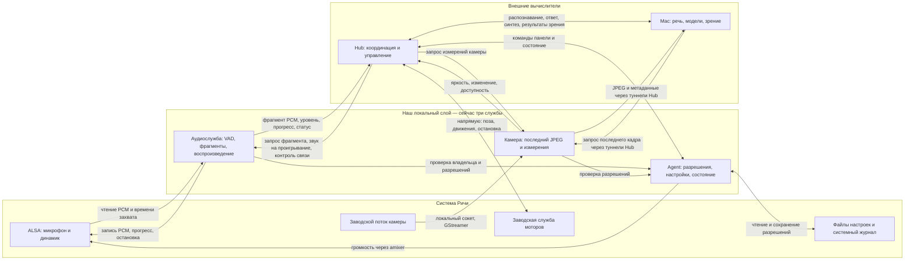

# Интерфейсы локального слоя Ричи

Схема текущего production-пути по коду и сохранённым конфигурациям, 17 ноября
2026 года. Это не проверка запущенных устройств и не проект нового API.
Центральный блок пока состоит из трёх служб. Старый разговорный цикл Agent
и экспериментальный native transport в основной путь ниже не включены.

Стрелки показывают вызовы и данные, а не отдельные физические соединения.
Наши Linux-службы также пишут обычные журналы в системный журнал; диагностические
отчёты сеансов сохраняются отдельно. Вспомогательные службы сети и очистки здесь
не показаны.

## Конкретные вызовы

| Кто вызывает → кого | Интерфейс | Данные и результат |
|---|---|---|
| Аудиослужба → ALSA | `snd_pcm_readi`, `snd_pcm_htimestamp` | PCM 16 кГц, два канала; выбирается один. Время захвата, затем VAD и формирование фрагмента. |
| Аудиослужба → ALSA | `snd_pcm_writei`, `snd_pcm_delay`, `snd_pcm_drain`, `snd_pcm_drop` | Моно PCM, измерение прогресса, завершение и остановка воспроизведения. |
| Камера → заводской поток | SDK/GStreamer, `try-pull-sample` из `/tmp/reachymini_camera_socket` | Получение изображения 1280×720; подготовка JPEG 640×360. Это локальный поток, а не HTTP `get image`. |
| Hub → аудиослужба | `POST /observation` | В ответе последний подготовленный фрагмент PCM в Base64, возраст и идентификаторы; при наличии — уровень звука. Hub забирает данные опросом. |
| Hub → аудиослужба | `POST /reserve`, `/start`, `/write`, `/finish`, `/progress`, `/stream-stop` | Резервирование воспроизведения, порции PCM, завершение, прогресс, остановка. Полная остановка сеанса — `/stop`; для остановки есть отдельный слушатель. |
| Hub → аудиослужба | UDP-протокол продления сеанса; также реализован `POST /lease` | Короткоживущее подтверждение работы контроллера. При его истечении локальный аудиосеанс закрывается. |
| Hub → камера | `GET /sensor` через SSH-туннель | Доступность, возраст, яркость и величина изменения изображения; без распознавания объектов. |
| Mac → камера | `GET /frame` через SSH-туннели с промежуточным Hub | Последний JPEG в Base64, номер, возраст и доступность. HTTP-видеопотока в этом интерфейсе нет. Возраст относится к получению изображения, точное время экспозиции неизвестно. |
| Hub → Agent | `GET /operator`, `/panel-state`; `POST /panel-control`, `/microphone`, `/motion-policy`, `/volume` | Разрешения, владелец микрофона, команды панели, громкость и состояние. |
| Agent → системный микшер | `amixer … sset …` | Громкость и mute/unmute при включённом управлении микшером. |
| Аудиослужба и камера → Agent | `GET /operator`; камера также читает файл разрешения | Проверка текущего допуска к работе; проверки не ограничены получением настройки при запуске. |
| Hub → заводская служба | `GET /api/state/full`, `/api/move/running`; `POST /api/move/goto`, `/api/move/stop` | Поза, активные движения, целевая поза и остановка. Этот путь сейчас обходит наши службы на Ричи. |

Ключевое для пересмотра: сейчас нет одного локального API, через который проходят
все функции робота. Камера отдельно отдаёт измерения Hub и изображения Mac;
движения и телеметрия моторов идут между Hub и заводской службой напрямую.
Нельзя изображать будущую единую службу как уже существующую.

## Источники в репозитории

- `src/reachy_companion/autonomous/alsa_capture.py`, `alsa_pcm.py` — системное аудио.
- `deploy/autonomous/device_audio_runtime.py`, `production_start.py` — локальный аудиоцикл и его параметры.
- `src/reachy_companion/autonomous/audio_peer.py` — обмен с Hub.
- `src/reachy_companion/autonomous/camera_sensor.py` — поток камеры и HTTP-интерфейс.
- `src/reachy_companion/agent.py` — настройки, разрешения, микшер.
- `src/reachy_companion/hub.py`, `autonomous/stock_motion_adapter.py` — заводское API движений.
- `deploy/current/hub/config/config.autonomous.mac.local.json.template` — потребитель измерений камеры.
- `deploy/current/mac/config/config.autonomous.mac.local.json.template` — потребитель изображений.
- `deploy/current/hub/systemd/reachy-robot-tunnel.service.template`, `deploy/current/mac/launchd/local.reachy.tunnels.plist.template` — туннели камеры.
